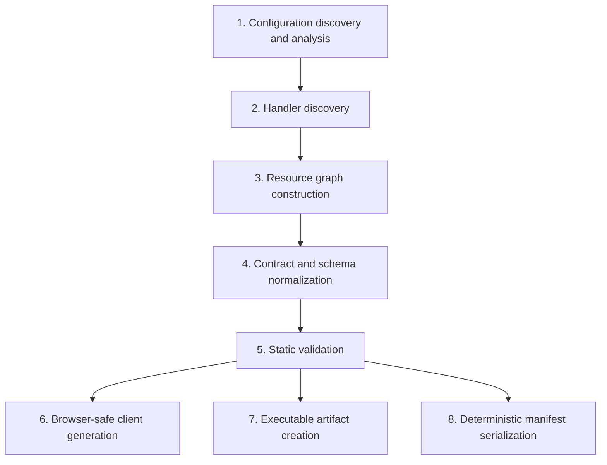

# Compiler

> **Status:** Planned, with **Implemented** foundations. Canonical JSON serialization (`canonicalJsonStringify`), the structured diagnostic model, and stage 4's schema normalization, fingerprints and compatibility checks ([schema contracts](../reference/schema-contracts.md)) are **Implemented** as library functions. The compilation pipeline, manifest schema, and client generation are **Planned**. See [ADR 0007](decisions/0007-separate-compiler-and-runtime.md).

The compiler (`@holqa/compiler`) will be one of Holqa's most important packages. It transforms an application's declarations and handlers into artifacts that the runtime, local environment, providers, and tools consume.

## Outputs

| Output | Description | Status |
| --- | --- | --- |
| Application manifest | Deterministic, versioned, infrastructure-neutral description of the resource graph. | Planned (serialization **Implemented**) |
| Executable artifacts | Bundled handler code for the Bun runtime. | Planned |
| Generated clients and API contracts | Browser-safe clients; OpenAPI documents. | Planned |
| Structured diagnostics | `Diagnostic` values with `HOLQA_*` codes. | Model **Implemented**; compiler diagnostics planned |

## Separation from the runtime

The compiler is conceptually and physically separate from the runtime ([ADR 0007](decisions/0007-separate-compiler-and-runtime.md)):

- The compiler runs at build time and produces artifacts. The runtime executes artifacts and never needs the compiler.
- `@holqa/sdk` and `@holqa/client` are forbidden from importing `@holqa/compiler` ([package boundaries](package-boundaries.md)).
- The compiler's own source must not import `bun`, `bun:*`, or `node:*` (enforced by ESLint). Host access such as file reading is expected to be injected or isolated, which keeps the core logic testable and deterministic.

## Pipeline

The planned pipeline stages:



| Stage | Responsibility | Example diagnostics (planned unless noted) |
| --- | --- | --- |
| 1. Configuration discovery and analysis | Locate `infra.ts`; obtain the application definition. | Missing or invalid `infra.ts`. |
| 2. Handler discovery | Resolve the `handlers` globs; find handler registrations and their identifiers. | Handler for an unknown resource. |
| 3. Resource graph construction | Build nodes (resources, handlers, configuration) and edges (triggers, uses, reads). | Duplicate identifiers; `HOLQA_RESOURCE_ID_INVALID` (**Implemented** via `parseResourceId`). |
| 4. Contract and schema normalization | Convert Standard Schema schemas into the normalized representation; compute fingerprints. | `HOLQA_SCHEMA_UNSUPPORTED`. |
| 5. Static validation | Check references, uniqueness, routes, requirements. | `HOLQA_RESOURCE_NOT_FOUND`; ambiguous routes; multiple queue consumers; incompatible requirements. |
| 6. Client generation | Emit browser-safe clients and OpenAPI for public contracts. | A public contract referencing a private type. |
| 7. Executable artifact creation | Hand off to a bundler to produce Bun artifacts. | Bundling failures. |
| 8. Manifest serialization | Serialize the validated graph with canonical JSON. | `HOLQA_MANIFEST_NOT_SERIALIZABLE` (**Implemented**). |

The compiler must detect at least: duplicate identifiers, invalid references, incompatible resource requirements, ambiguous routes, and invalid schemas.

## Analysis and untrusted code

Stage 1 obtains the application by **evaluating** `infra.ts` and the handler modules in a host process, then passes the resulting descriptors to the runtime-neutral compiler (**Accepted design**, [ADR 0014](decisions/0014-evaluation-based-manifest-extraction.md)). M0 found that static analysis cannot recover imported or composed schemas; it remains useful only as a partial index for editors. See the [compilation experiment](../../experiments/compiler/README.md) for the measured results.

Constraint: **the compiler must not execute arbitrary user configuration code unsandboxed while claiming that evaluation is secure.** Because the compiler evaluates modules ([ADR 0014](decisions/0014-evaluation-based-manifest-extraction.md)), the documentation says plainly that compiling an application runs its code. Declarations are pure and deterministic ([ADR 0003](decisions/0003-explicit-resource-declarations.md)) so that evaluation stays predictable. See [security](../concepts/security.md#untrusted-build-time-execution).

## Compile vs. bundle

Compilation (analysis, graph, validation, manifest, client generation) and bundling (producing executable JavaScript) are separate concerns:

- The manifest can be produced and inspected without bundling, which keeps `holqa inspect` fast and makes the manifest usable by tools that never execute code.
- Bundler choice can change without changing the manifest format.
- Bundling failures and graph validation failures are reported separately.

## Manifest principles

The manifest is the compiler's primary output and the contract between compilation and everything downstream. Its schema does not exist yet. It must be:

| Principle | Meaning |
| --- | --- |
| **Deterministic** | The same source produces byte-identical output on every run and machine. No timestamps, absolute paths, random identifiers, or iteration-order dependence. |
| **Versioned** | Carries an explicit manifest format version so that consumers can reject versions they do not understand. |
| **Infrastructure-neutral** | Describes logical resources, contracts, and required capabilities, never provider-specific resources (no cloud resource types, ARNs, or provider configuration). |
| **Complete for inspection** | Contains enough information to list resources, handlers, routes, schemas, and requirements without loading application code. |
| **Free of secrets** | Records that a secret is required and its schema, never a value. |

### Canonical JSON (Implemented)

`canonicalJsonStringify(value)` in `@holqa/compiler` is the serialization foundation for the manifest:

- Object keys are sorted (by UTF-16 code unit order) at every depth.
- Two-space indentation, `\n` line endings, no trailing newline.
- `-0` is written as `0`.
- It never silently drops or coerces data. It throws `CanonicalJsonError` for `undefined`, functions, symbols, bigints, `NaN` and `Infinity`, non-plain objects (`Date`, `Map`, class instances), and circular references.
- The error's `diagnostic` property carries code `HOLQA_MANIFEST_NOT_SERIALIZABLE`, and the message includes the JSON path of the offending value (for example `$.resources[0].id`).

```ts
import { canonicalJsonStringify } from "@holqa/compiler";

canonicalJsonStringify({ b: 1, a: [true, null] });
// {
//   "a": [
//     true,
//     null
//   ],
//   "b": 1
// }
```

Because `JSON.stringify` silently drops `undefined` and functions and converts `NaN` to `null`, it is not suitable for a manifest whose bytes must faithfully represent the graph.

### Illustrative manifest excerpt

> **Illustrative only.** The manifest schema has not been designed. Field names and structure below are examples of the principles, not a specification.

```json
{
  "app": {
    "name": "commerce"
  },
  "configuration": [
    {
      "kind": "secret",
      "name": "DATABASE_URL",
      "schema": {
        "minLength": 1,
        "type": "string"
      }
    }
  ],
  "handlers": [
    {
      "id": "orders.process",
      "module": "src/orders/process.handler.ts",
      "trigger": {
        "kind": "queue.message",
        "resource": "order-processing"
      },
      "uses": []
    }
  ],
  "manifestVersion": 1,
  "resources": [
    {
      "id": "order-processing",
      "kind": "queue",
      "message": {
        "fingerprint": "sha256:…",
        "schemaVersion": 1
      },
      "requires": [
        "queue.deadLetter",
        "queue.delivery.atLeastOnce"
      ]
    }
  ]
}
```

Note the absence of provider details: nothing says which queue service backs `order-processing`. That is the binding's job ([infrastructure providers](../concepts/infrastructure-providers.md)).

## Diagnostics

Every compiler failure is a `Diagnostic` from `@holqa/core`:

- `code`: a registered, versioned `HOLQA_<AREA>_<PROBLEM>` code. Codes are a public contract and are never renamed or reused.
- `severity`: `error` (the compilation fails), `warning`, or `info`.
- `message`, an optional source `location` (`file`, 1-based `line` and `column`), and an optional actionable `hint`.

Compiler output must be machine-readable, stable, and suitable for agents: the planned `holqa build --json` and `holqa inspect --json` will emit diagnostics in the same `{"diagnostics":[...]}` shape the CLI already uses. See [diagnostic codes](../reference/diagnostic-codes.md).

## Future: compatibility checking

> **Status:** The checker itself is **Implemented** as `checkSchemaCompatibility` in `@holqa/compiler` ([schema contracts](../reference/schema-contracts.md#compatibility)); running it against a deployed manifest is **Planned**.

Schema fingerprints in the manifest enable comparing a new manifest with a previously deployed one to detect breaking changes in queue messages and public HTTP/RPC contracts. A compatibility engine is not part of the initial compiler; see [type safety and schemas](../concepts/type-safety-and-schemas.md#compatibility-and-evolution).

## Related

- [Architecture overview](overview.md)
- [Resource graph](../concepts/resource-graph.md)
- [Diagnostic codes](../reference/diagnostic-codes.md)
- [ADR 0007: Separate compiler and runtime](decisions/0007-separate-compiler-and-runtime.md)
