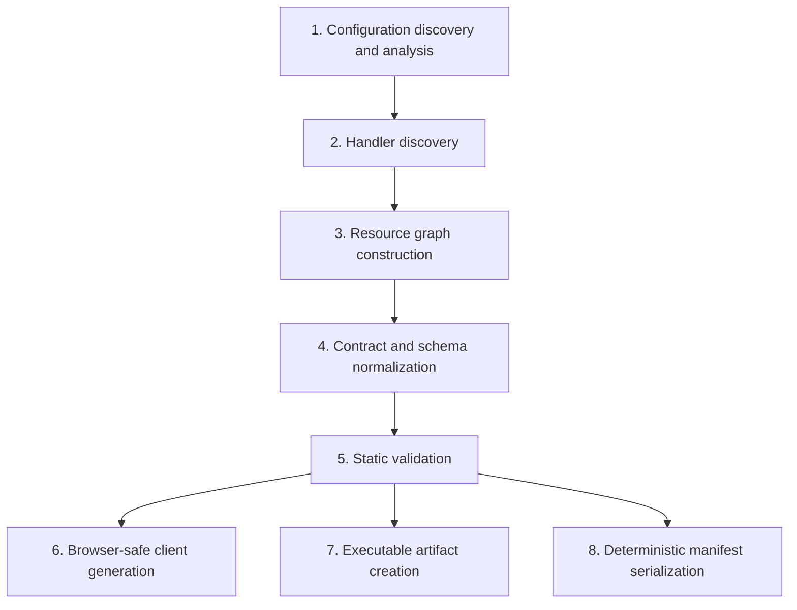

# Compiler

> **Status:** **Implemented** for stages 1 to 5 and 8: application loading, handler discovery, resource graph construction, schema normalization, static validation and manifest serialization, exposed as `holqa inspect` and `holqa build --manifest`. Client generation (stage 6) and executable artifact creation (stage 7) are **Planned**. The normative format and rules are in the [compiler specification](../reference/compiler-specification.md). See [ADR 0007](decisions/0007-separate-compiler-and-runtime.md), [ADR 0014](decisions/0014-evaluation-based-manifest-extraction.md) and [ADR 0022](decisions/0022-manifest-v1-and-entry-point-map.md).

The compiler (`@holqa/compiler`) transforms an application's declarations and handlers into artifacts that the runtime, local environment, providers, and tools consume.

## Outputs

| Output | Description | Status |
| --- | --- | --- |
| Application manifest | Deterministic, versioned, infrastructure-neutral description of the resource graph (`manifest.json`). | **Implemented** (version 1) |
| Entry point map | Where each handler is implemented, tied to the manifest by fingerprint (`entrypoints.json`). | **Implemented** |
| Executable artifacts | Bundled handler code for the Bun runtime. | Planned |
| Generated clients and API contracts | Browser-safe clients; OpenAPI documents. | Planned |
| Structured diagnostics | `Diagnostic` values with `HOLQA_*` codes. | **Implemented** |

## Separation from the runtime

The compiler is conceptually and physically separate from the runtime ([ADR 0007](decisions/0007-separate-compiler-and-runtime.md)):

- The compiler runs at build time and produces artifacts. The runtime executes artifacts and never needs the compiler.
- `@holqa/sdk` and `@holqa/client` are forbidden from importing `@holqa/compiler` ([package boundaries](package-boundaries.md)).
- The compiler's own source must not import `bun`, `bun:*`, or `node:*` (enforced by ESLint). Host access is injected: the CLI lists files, evaluates modules and passes the results to `compileApplication`, which keeps the compiler testable in memory and deterministic.

## Pipeline

The pipeline stages:



| Stage | Responsibility | Diagnostics | Status |
| --- | --- | --- | --- |
| 1. Configuration discovery and analysis | Locate `infra.ts` (or `--app`); evaluate it in the analysis process. | `HOLQA_APP_NOT_FOUND`, `HOLQA_APP_INVALID`, `HOLQA_MODULE_EVALUATION_FAILED`, `HOLQA_ANALYSIS_FAILED` | **Implemented** |
| 2. Handler discovery | Match the `handlers` globs (`selectHandlerModules`); find exported registrations (`discoverHandlers`). | `HOLQA_HANDLER_PATTERN_UNMATCHED`, `HOLQA_HANDLER_ID_DUPLICATE` | **Implemented** |
| 3. Resource graph construction | Normalize resources, handlers and configuration; derive required capabilities; `buildResourceGraph` builds nodes and declared edges. | `HOLQA_RESOURCE_ID_DUPLICATE`, `HOLQA_DECLARATION_INVALID` | **Implemented** |
| 4. Contract and schema normalization | Convert Standard Schema schemas into the normalized representation; compute fingerprints. | `HOLQA_SCHEMA_UNSUPPORTED`, `HOLQA_SCHEMA_FIDELITY_UNVERIFIED`, `HOLQA_SCHEMA_RUNTIME_ONLY` | **Implemented** |
| 5. Static validation | Check references, trigger kinds, one consumer per queue, routes. | `HOLQA_RESOURCE_NOT_FOUND`, `HOLQA_TRIGGER_INVALID`, `HOLQA_QUEUE_CONSUMER_DUPLICATE`, `HOLQA_ROUTE_CONFLICT` | **Implemented**; checking requirements against a binding is Planned |
| 6. Client generation | Emit browser-safe clients and OpenAPI for public contracts. | A public contract referencing a private type. | Planned |
| 7. Executable artifact creation | Hand the entry point map to a bundler to produce Bun artifacts. | Bundling failures. | Planned |
| 8. Manifest serialization | Serialize the manifest and entry point map with canonical JSON. | `HOLQA_MANIFEST_NOT_SERIALIZABLE` | **Implemented** |

The compiler detects duplicate identifiers, invalid references, trigger mismatches, conflicting routes and invalid schemas. Incompatible requirements are detected when a binding is installed (`checkCapabilities`); doing so at build time is planned.

## Analysis and untrusted code

Stage 1 obtains the application by **evaluating** `infra.ts` and the handler modules, then passes the results to the runtime-neutral compiler (**Implemented**, [ADR 0014](decisions/0014-evaluation-based-manifest-extraction.md)). M0 found that static analysis cannot recover imported or composed schemas; the compiler uses it only to add line and column numbers to diagnostics.

The CLI evaluates in a dedicated Bun process with an allowlisted environment (no application secrets), `--no-install`, closed standard input and a timeout, and validates the report it sends back ([ADR 0022](decisions/0022-manifest-v1-and-entry-point-map.md)). This reduces exposure; it is not a sandbox. See the [security model](../reference/compiler-specification.md#security-model). See the [compilation experiment](../../experiments/compiler/README.md) for the measured results.

Constraint: **the compiler must not execute arbitrary user configuration code unsandboxed while claiming that evaluation is secure.** Because the compiler evaluates modules ([ADR 0014](decisions/0014-evaluation-based-manifest-extraction.md)), the documentation says plainly that compiling an application runs its code. Declarations are pure and deterministic ([ADR 0003](decisions/0003-explicit-resource-declarations.md)) so that evaluation stays predictable. See [security](../concepts/security.md#untrusted-build-time-execution).

## Compile vs. bundle

Compilation (analysis, graph, validation, manifest, client generation) and bundling (producing executable JavaScript) are separate concerns:

- The manifest is produced and inspected without bundling (`holqa inspect`, `holqa build --manifest`), which keeps inspection fast and makes the manifest usable by tools that never execute code. Bundling is planned and will consume the entry point map.
- Bundler choice can change without changing the manifest format.
- Bundling failures and graph validation failures are reported separately.

## Manifest principles

The manifest is the compiler's primary output and the contract between compilation and everything downstream. Version 1 is specified in the [compiler specification](../reference/compiler-specification.md#manifest-version-1), with a published JSON Schema. It is:

| Principle | Meaning |
| --- | --- |
| **Deterministic** | The same source produces byte-identical output on every run and machine. No timestamps, absolute paths, random identifiers, or iteration-order dependence. |
| **Versioned** | Carries an explicit manifest format version so that consumers can reject versions they do not understand. |
| **Infrastructure-neutral** | Describes logical resources, contracts, and required capabilities, never provider-specific resources (no cloud resource types, ARNs, or provider configuration). |
| **Complete for inspection** | Contains enough information to list resources, handlers, routes, schemas, and requirements without loading application code. |
| **Free of secrets** | Records that a secret is required and its schema, never a value. |

### Canonical JSON (Implemented)

`canonicalJsonStringify(value)` in `@holqa/compiler` is the serialization foundation for the manifest:

- Object keys are sorted (by UTF-16 code unit order) at every depth.
- Two-space indentation, `\n` line endings, no trailing newline.
- `-0` is written as `0`.
- It never silently drops or coerces data. It throws `CanonicalJsonError` for `undefined`, functions, symbols, bigints, `NaN` and `Infinity`, non-plain objects (`Date`, `Map`, class instances), and circular references.
- The error's `diagnostic` property carries code `HOLQA_MANIFEST_NOT_SERIALIZABLE`, and the message includes the JSON path of the offending value (for example `$.resources[0].id`).

```ts
import { canonicalJsonStringify } from "@holqa/compiler";

canonicalJsonStringify({ b: 1, a: [true, null] });
// {
//   "a": [
//     true,
//     null
//   ],
//   "b": 1
// }
```

Because `JSON.stringify` silently drops `undefined` and functions and converts `NaN` to `null`, it is not suitable for a manifest whose bytes must faithfully represent the graph.

### Example

[`examples/manifest/expected/shop.manifest.json`](../../examples/manifest/expected/shop.manifest.json) is the real manifest of the example shop application, checked by its tests. Note the absence of provider details: nothing says which queue service backs `order-placed`. That is the binding's job ([infrastructure providers](../concepts/infrastructure-providers.md)).

## Diagnostics

Every compiler failure is a `Diagnostic` from `@holqa/core`:

- `code`: a registered, versioned `HOLQA_<AREA>_<PROBLEM>` code. Codes are a public contract and are never renamed or reused.
- `severity`: `error` (the compilation fails), `warning`, or `info`.
- `message`, an optional source `location` (`file`, 1-based `line` and `column`), and an optional actionable `hint`.

Compiler output is machine-readable, stable, and suitable for agents: `holqa inspect --json` and `holqa build --manifest --json` report failures in the same `{"diagnostics":[...]}` shape as every CLI error, and include warnings in their output documents. Compilation reports every problem at once, sorted by location. See [diagnostic codes](../reference/diagnostic-codes.md).

## Future: compatibility checking

> **Status:** The checker itself is **Implemented** as `checkSchemaCompatibility` in `@holqa/compiler` ([schema contracts](../reference/schema-contracts.md#compatibility)), and manifests record every contract's fingerprint and version; running the checker against a deployed manifest is **Planned**.

Schema fingerprints in the manifest enable comparing a new manifest with a previously deployed one to detect breaking changes in queue messages and public HTTP/RPC contracts. A compatibility engine is not part of the initial compiler; see [type safety and schemas](../concepts/type-safety-and-schemas.md#compatibility-and-evolution).

## Related

- [Compiler specification](../reference/compiler-specification.md)
- [Architecture overview](overview.md)
- [Resource graph](../concepts/resource-graph.md)
- [Diagnostic codes](../reference/diagnostic-codes.md)
- [ADR 0007: Separate compiler and runtime](decisions/0007-separate-compiler-and-runtime.md)
