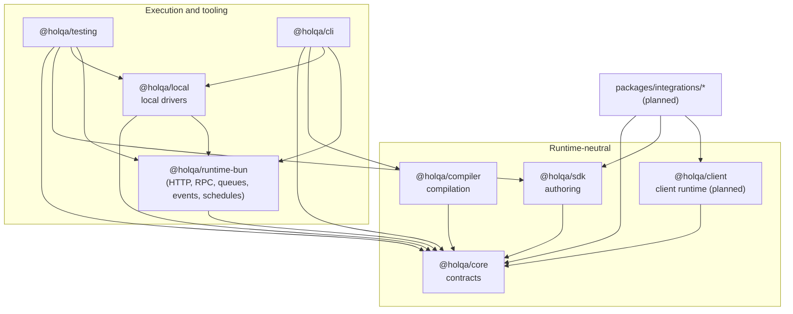
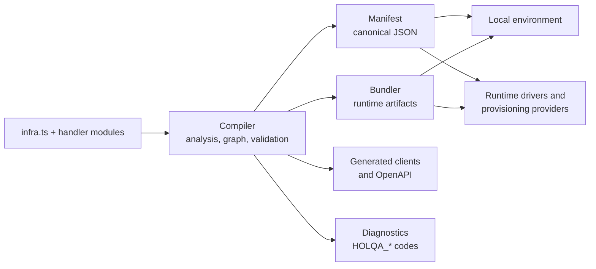

# Architecture overview

> **Status:** Accepted design. The package boundaries and their enforcement are **Implemented**; `@holqa/core` (contracts and the descriptor protocol), `@holqa/sdk` (the application and resource model), `@holqa/testing` (type assertions and `createTestApp`), `@holqa/compiler` (canonical JSON, application compilation, graph validation and manifest version 1), `@holqa/runtime-bun` (invocation dispatcher, lifecycle, HTTP routes, RPC procedures, and queue, object event and schedule delivery), `@holqa/local` (local queue, storage and scheduler drivers) and `@holqa/cli` (help, version, `inspect`, `build --manifest`, the `holqa dev` supervisor and the local operation commands) contain implemented parts. All other layers are planned.

This document describes Holqa's layers, how packages map to them, and how data flows from source code to a running application. For the reasoning behind individual decisions, see the [ADRs](decisions/README.md).

## Layers

Holqa is organized into layers whose dependencies point **inward**, toward framework-neutral contracts. Execution infrastructure, tooling, and integrations depend on core abstractions; core never depends on them.

| Layer | Concern | Packages | Runtime-neutral? |
| --- | --- | --- | --- |
| **Contracts** | Resource model, diagnostics, identity, schema representation, shared types. | `@holqa/core` | Yes. No Bun, Node, or other Holqa imports. |
| **Authoring** | Public API for declaring resources and handlers; typed handles. | `@holqa/sdk` (implemented: application and resource model, HTTP routes, RPC procedures, middleware) | Yes |
| **Client** | Browser-safe runtime for generated clients. | `@holqa/client` (planned) | Yes |
| **Compilation** | Analysis, resource graph, manifest IR, diagnostics, client generation. | `@holqa/compiler` | Yes, in its own source (no Bun or Node imports). |
| **Execution** | Running handlers on Bun; invocation dispatcher and transports. | `@holqa/runtime-bun` (implemented: dispatcher, lifecycle, HTTP and RPC, queue, object event and schedule delivery) | No (Bun) |
| **Local environment** | Local runtime drivers and emulators. | `@holqa/local` (implemented: SQLite-backed queues, filesystem buckets, clock-driven scheduler) | No |
| **Testing** | Deterministic test utilities and fixtures. | `@holqa/testing` (implemented: type assertions, `createTestApp`) | No |
| **Tooling** | Developer CLI composing compiler, runtime, and local environment. | `@holqa/cli` (implemented: `inspect`, `build --manifest`, `dev`, `invoke`, `queue send`, `storage put`, `cron run`, `state`, `doctor`) | No (Bun) |
| **Integrations** | Adapters for schema libraries, Effect, oRPC, TanStack Query, and others. | `packages/integrations/*` (`@holqa/zod` implemented; others planned) | Depends on integration |
| **Bindings** | Production runtime drivers and provisioning providers. | Not yet scoped | No |

Arrows point from a package to the packages it may depend on. The full rules and their enforcement are in [package boundaries](package-boundaries.md).

## How concerns map to packages

The [resource graph](../concepts/resource-graph.md) separates three concerns. Each maps to distinct packages:

| Concern | Packages |
| --- | --- |
| Resource definitions | `@holqa/core` (model), `@holqa/sdk` (declaration API) |
| Operations and handlers | `@holqa/sdk` (typed handles, handler registration), `@holqa/runtime-bun` (invocation) |
| Infrastructure bindings | `@holqa/local` (local drivers), future driver and provider packages |

Cross-cutting concerns:

| Concern | Packages |
| --- | --- |
| Diagnostics | `@holqa/core` defines `Diagnostic` and the code registry; every other package emits them. |
| Serialization | `@holqa/compiler` owns canonical JSON, the manifest schema and the entry point map format. |
| Schemas | `@holqa/core` (validation, wire payloads, the adapter contract), `@holqa/compiler` (normalized contracts, fingerprints, compatibility), `packages/integrations/*` (library adapters such as `@holqa/zod`). |

## Data flow

The intended flow from source to execution (all **Planned** except where noted):

1. Developers write `infra.ts` and handler modules using `@holqa/sdk` (**Implemented** for queues, buckets, schedules, HTTP routes and RPC procedures).
2. The compiler analyzes them, builds the resource graph, normalizes schemas, validates the graph, and emits a deterministic manifest and diagnostics (**Implemented**: `holqa inspect` and `holqa build --manifest`, see the [compiler specification](../reference/compiler-specification.md)), and generated clients (**Planned**).
3. Bundling produces executable artifacts for Bun as a separate step ([ADR 0007](decisions/0007-separate-compiler-and-runtime.md)).
4. The local environment or a production binding reads the manifest, validates capabilities, and runs the artifacts. **Implemented** today without bundling: `@holqa/runtime-bun` loads `holqa build --manifest` output with `loadCompiledApplication`, serves HTTP routes and RPC procedures, and delivers queue messages, object events and scheduled runs from a binding such as `@holqa/local` ([runtime reference](../reference/runtime.md), [local environment](../reference/local.md)).

See [compiler](compiler.md) for the pipeline in detail.

## Key architectural decisions

| Decision | ADR |
| --- | --- |
| pnpm + Turborepo monorepo | [0001](decisions/0001-monorepo-tooling-pnpm-turborepo.md) |
| Bun as the primary runtime | [0002](decisions/0002-bun-as-primary-runtime.md) |
| Explicit, declarative resource declarations | [0003](decisions/0003-explicit-resource-declarations.md) |
| Stable logical resource identities | [0004](decisions/0004-stable-logical-resource-identities.md) |
| Infrastructure-independent resource contracts | [0005](decisions/0005-infrastructure-independent-resource-contracts.md) |
| Standard Schema and a portable schema representation (superseded) | [0006](decisions/0006-standard-schema-and-portable-schema-representation.md) |
| Compiler and runtime are separate | [0007](decisions/0007-separate-compiler-and-runtime.md) |
| Agent instructions and skills organization | [0008](decisions/0008-agent-instructions-and-skills.md) |
| Test placement and TypeScript standards | [0009](decisions/0009-test-placement-and-typescript-standards.md) |
| TypeScript 6 until tooling supports 7 | [0010](decisions/0010-typescript-6-until-tooling-supports-7.md) |
| `@/` path aliases in library packages | [0011](decisions/0011-path-aliases-in-library-packages.md) |
| Source-inferred types and reply helpers | [0012](decisions/0012-source-inferred-types-and-reply-helpers.md) |
| A descriptor protocol in `@holqa/core` | [0013](decisions/0013-descriptor-protocol-in-core.md) |
| Evaluation-based manifest extraction | [0014](decisions/0014-evaluation-based-manifest-extraction.md) |
| Runtime generations and reload | [0015](decisions/0015-runtime-generations-and-reload.md) |
| Schema adapters and conversion fidelity | [0016](decisions/0016-schema-adapters-and-conversion-fidelity.md) |
| Package layers after M0 | [0017](decisions/0017-package-layers-after-m0.md) |
| A common invocation engine, with HTTP and RPC as its first transports | [0023](decisions/0023-common-invocation-engine-and-http-rpc-execution.md) |

## Build and packaging

All packages build the same way (**Implemented**):

- tsdown (Rolldown) produces ESM-only `.js` and bundled `.d.ts` files in `dist/`.
- Inside a package, source and tests import via the `@/` alias (mapped to `./src/*`). tsdown resolves these aliases, and `examples/package-smoke` verifies that no `@/` specifier leaks into published output ([ADR 0011](decisions/0011-path-aliases-in-library-packages.md)).
- Cross-package imports resolve to the dependency's built `dist/` through its `exports` map, which is why `typecheck` and `test` depend on `^build` in Turborepo.
- Every package is `"private": true` until it has a meaningful API.

## Related

- [Package boundaries](package-boundaries.md)
- [Compiler](compiler.md)
- [Status model](status-model.md)
- [Packages reference](../reference/packages.md)
