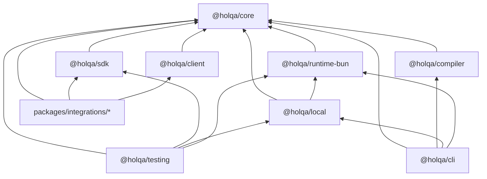

# Package boundaries

> **Status:** Implemented. Dependency directions and import restrictions are enforced by `scripts/check-boundaries.ts` and ESLint. Several packages listed here do not exist yet; their rules are already defined so they apply from the first commit.

Holqa's packages are layered so that framework-neutral contracts never depend on execution infrastructure, and the public SDK never becomes a circular dependency hub. This page lists every package, what it may depend on, and how those rules are enforced. For the layer model, see the [architecture overview](overview.md).

## Packages and allowed dependencies

| Package | Path | Responsibility | Status | May depend on (internal) |
| --- | --- | --- | --- | --- |
| `@holqa/core` | `packages/core` | Framework-neutral contracts, resource identity, diagnostics, descriptor protocol, runtime binding contract. | **Implemented** (contracts) | none |
| `@holqa/sdk` | `packages/sdk` | Primary public developer-facing SDK: `defineApp`, resource factories, typed handles. | **Implemented** (application and resource model, HTTP routes, RPC procedures, middleware) | `core` |
| `@holqa/client` | `packages/client` | Framework-independent, browser-safe generated-client runtime. | Planned | `core` |
| `@holqa/compiler` | `packages/compiler` | Resource analysis, manifest IR, diagnostics, compilation. | **Implemented** (canonical JSON, application compilation, graph validation, manifest version 1 and entry point map); client generation and bundling Planned | `core` |
| `@holqa/runtime-bun` | `packages/runtime-bun` | Bun execution: invocation dispatcher, lifecycle, HTTP, RPC, queue, object event and schedule transports. | **Implemented** (dispatcher, lifecycle, HTTP routes, RPC procedures, `Bun.serve`, queue, object event and schedule delivery); worker isolation Planned | `core` |
| `@holqa/local` | `packages/local` | Local runtime drivers: SQLite-backed queues and event state, filesystem object storage, a clock-driven scheduler, inspection. | **Implemented** (drivers, inspection, trace storage, manual trigger metadata) | `core`, `runtime-bun` |
| `@holqa/testing` | `packages/testing` | Testing utilities, fixtures, deterministic execution. | **Implemented** (type assertions, `createTestApp`) | `core`, `sdk`, `local`, `runtime-bun` |
| `@holqa/cli` | `packages/cli` | Developer CLI. | **Implemented** (help, version, `--json`, `inspect` with `--cycles`, `build --manifest`, `dev`, `invoke`, `queue send`, `queue redrive`, `storage put`, `cron run`, `state`, `doctor`); `openapi generate` and bundling Proposed | `core`, `compiler`, `local`, `runtime-bun` |
| Schema adapters | `packages/integrations/{zod,valibot,...}` | Convert one schema library's schemas for the compiler ([ADR 0016](decisions/0016-schema-adapters-and-conversion-fidelity.md)). | **Implemented** for Zod (`@holqa/zod`); others Planned | `core` only (enforced for `@holqa/zod`) |
| Framework adapters | `packages/integrations/{orpc,tanstack-query,effect,...}` | Handler, transport, and client adapters. | Planned | `core`, `sdk`, `client` |
| Drivers and providers | future `packages/providers/*` | Runtime drivers and provisioning providers. | Planned | `core` only (Accepted design; no packages yet) |
| Experiments | `experiments/*` | Disposable M0 prototypes ([experiments](../../experiments/README.md)). | Not framework code | Mirror of this table (`experimentDependencies`); never a dependency of `packages/*` |
| Examples | `examples/*` | Example applications and smoke tests. | `package-smoke`, `schema-evolution` and `manifest` **Implemented**; `commerce` type-checked against the experiments | anything |

Final npm names for integration packages are not decided. The layer decisions for schema adapters, framework adapters, drivers, providers and experiments are recorded in [ADR 0017](decisions/0017-package-layers-after-m0.md), which also confirms the existing directions with the M0 prototypes.



### Rationale for notable rules

- **`core` depends on nothing.** It is the innermost layer and must remain usable in any JavaScript environment.
- **`sdk` and `client` must not import the compiler.** Application code and browser bundles must never pull in compiler internals. Compile-time knowledge flows through generated artifacts and the manifest, not imports.
- **`sdk` does not depend on `runtime-bun`.** Typed handles describe operations; the runtime supplies their implementation. This keeps the SDK neutral and avoids a dependency hub.
- **`local` depends on `runtime-bun`, not the reverse.** The runtime is the execution primitive; local emulation is one way of binding resources around it.
- **Integrations depend inward only.** Adapters for third-party libraries never become dependencies of core packages.

## Runtime-neutral packages

`@holqa/core`, `@holqa/compiler`, `@holqa/sdk`, and `@holqa/client` must not import:

- `bun`
- `bun:*` modules
- `node:*` modules

Additionally, `@holqa/sdk` and `@holqa/client` must not import `@holqa/compiler`, any `@holqa/runtime-*` package, `@holqa/local`, `@holqa/cli`, or `@holqa/testing`. `@holqa/core` must not import any `@holqa/*` package.

## Enforcement

Two independent mechanisms enforce the rules. Both run as part of `pnpm check`.

### `scripts/check-boundaries.ts`

Run with `pnpm boundaries:check` (executed by Bun). It discovers every package under `packages/`, `packages/integrations/`, `examples/`, and `experiments/`, then checks:

| Check | Failure example |
| --- | --- |
| Internal dependencies follow the allowed-directions table. | `@holqa/core` declaring a dependency on `@holqa/sdk`. |
| A framework package is listed in the table. | A new `packages/foo` without a decided dependency direction. |
| Internal dependencies use the `workspace:` protocol. | `"@holqa/core": "^0.1.0"`. |
| The workspace package graph has no cycles. | `a → b → a`. |
| Every `@holqa/*` import in `src/` is declared in `package.json`. | Importing `@holqa/core` without declaring it. |
| Modules within a package's `src/` have no circular imports. | `src/a.ts ↔ src/b.ts`. |
| No test files inside `src/`. | `src/foo.test.ts`. |
| Experiments follow `experimentDependencies`; their `src/` imports only production dependencies. | `experiments/compiler/src` importing `@holqa/experiment-sdk`. |

The allowed-directions table in the script is the source of truth; this document must match it. Adding a new framework package requires adding it to the script, which forces a deliberate decision about its dependencies.

### ESLint `no-restricted-imports`

The root `eslint.config.mjs` applies import restrictions by file path:

| Files | Restriction |
| --- | --- |
| All files | No deep imports into another package's `src/` or `dist/` (for example `@holqa/core/src/result`). Use the package's public entry point. |
| `packages/{core,compiler,sdk,client}/src/**` and `experiments/{model,sdk,schema-adapters,compiler}/src/**` | No `bun`, `bun:*`, or `node:*`; no `@holqa/runtime-*`, `@holqa/local`, `@holqa/cli`, `@holqa/testing`. |
| `packages/core/src/**` | No `@holqa/*` imports at all. |
| `packages/{sdk,client}/src/**` and `experiments/sdk/src/**` | Additionally, no `@holqa/compiler`. |
| `experiments/{model,schema-adapters,compiler,runtime-bun}/src/**` | No imports of the SDK prototype (and, outside the runtime, the runtime prototype), including type-only imports, which the boundary script cannot see. |
| `**/src/**/*.{test,spec}.{ts,tsx}` | Rejected: tests belong under `tests/`, mirroring `src/`. |

ESLint gives fast editor feedback; the boundary script catches what ESLint cannot see (`package.json` declarations, package-level cycles).

## Public exports policy

- Each package exposes a single entry point through its `exports` map:

  ```json
  {
    "exports": {
      ".": {
        "types": "./dist/index.d.ts",
        "import": "./dist/index.js"
      },
      "./package.json": "./package.json"
    },
    "files": ["dist"],
    "sideEffects": false
  }
  ```

- `src/index.ts` is the public API. Anything not exported from it is internal, even if it is exported from a module inside `src/`.
- Other packages import only from the package name (`@holqa/core`), never from subpaths into `src/` or `dist/`.
- Packages are ESM-only and ship bundled `.d.ts` declarations. `@/` aliases are resolved at build time ([ADR 0011](decisions/0011-path-aliases-in-library-packages.md)).
- Additional subpath exports require a documented reason (for example a separate browser-safe entry point).
- Public API changes require consideration of backward compatibility and, once packages are publishable, a Changeset ([releasing](../contributing/releasing.md)).

## Private until meaningful

Every package is `"private": true` until it has a meaningful, documented, tested API. This prevents accidental publication of scaffolding. Planned packages exist only as directories with a README describing their intended responsibility; they have no `package.json`, so they are not workspace packages and are not built or tested.

Removing `"private": true` from a package is a release decision. See [releasing](../contributing/releasing.md).

## Changing a boundary

1. Discuss the change and record it in an ADR if it alters the layer model.
2. Update `allowedDependencies` (or `integrationDependencies`) in `scripts/check-boundaries.ts`.
3. Update the ESLint restrictions in `eslint.config.mjs` if import rules change.
4. Update this document and the [architecture overview](overview.md).
5. Run `pnpm check`.

## Related

- [Architecture overview](overview.md)
- [Packages reference](../reference/packages.md)
- [Development setup](../contributing/development.md)
- [ADR 0001: Monorepo tooling](decisions/0001-monorepo-tooling-pnpm-turborepo.md)
