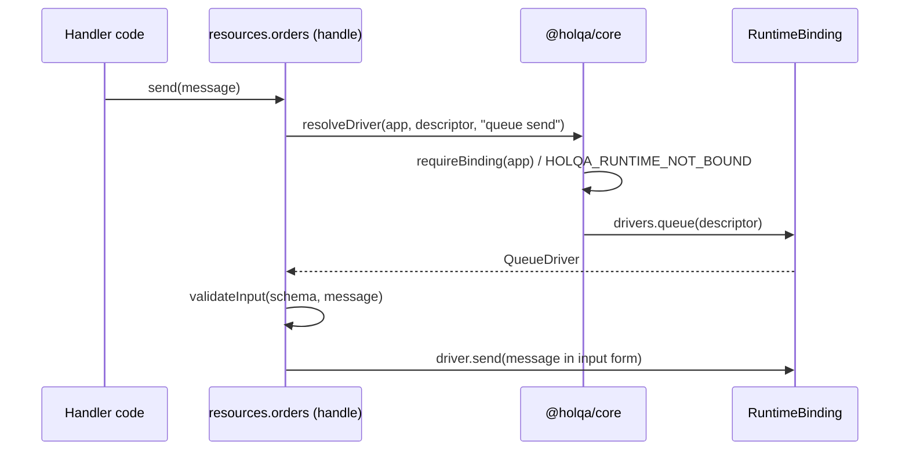
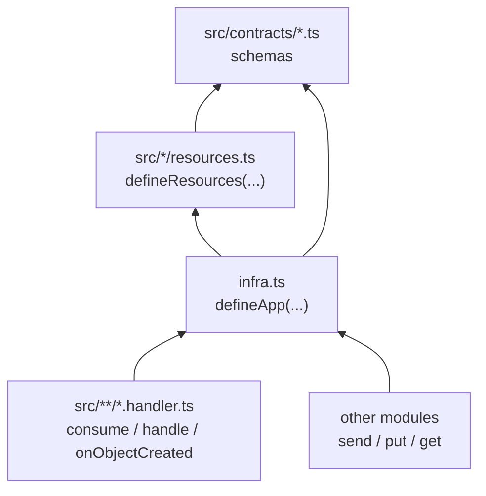

# Resource model

> **Status:** Implemented — the descriptor protocol, kind registries, handler model and runtime binding contract in `@holqa/core`, and the declaration API in `@holqa/sdk`. The compiler pipeline that reads descriptors into a manifest is **Implemented** ([compiler specification](../reference/compiler-specification.md)). Execution of HTTP routes and RPC procedures is **Implemented** in `@holqa/runtime-bun` ([runtime reference](../reference/runtime.md)); queue, storage and schedule delivery and real drivers are **Planned**.

This page describes how Holqa represents an application internally: the descriptors every SDK value carries, the typed registries that define resource and trigger kinds, how handlers separate metadata from code, how a logical handle reaches an implementation at run time, and which modules and packages depend on which. For the developer-facing view, see the [application model](../concepts/application-model.md).

Decisions: [ADR 0013](decisions/0013-descriptor-protocol-in-core.md) (descriptor protocol), [ADR 0018](decisions/0018-typed-kind-registries-in-the-descriptor-protocol.md) (typed registries), [ADR 0019](decisions/0019-declaration-time-validation.md) (declaration-time validation), [ADR 0020](decisions/0020-runtime-binding-resolution.md) (runtime binding).

## Three layers of a declaration

| Layer | Example | Lives in | Read by |
| --- | --- | --- | --- |
| Typed handle | `resources.orders` with `send(message: InferInput<S>)` | `@holqa/sdk` | Application code, through TypeScript inference |
| Descriptor | `{ protocol: 1, type: "resource", kind: "queue", id: "order-processing", config, requirements, schemas }` | `@holqa/core` types, created by the SDK | Compiler, runtimes, test utilities, other front ends |
| Binding | A `RuntimeBinding` that supplies a queue driver | Runtimes, local drivers, tests | Handles, when an operation runs |

Every SDK value carries its descriptor under the string key `~holqa`. A string key, unlike a `unique symbol` or a class, keeps values readable when an installation contains two copies of `@holqa/core`.

## Descriptors

| Descriptor | Fields | Mutable? |
| --- | --- | --- |
| `AppDescriptor` | `name` (`ResourceId`), `description?`, `handlers: { include, exclude }`, `resources`, `config`, `binding` | Only `binding.current` |
| `ResourceDescriptorOf<Kind>` | `kind`, `id` (`ResourceId`), `config`, `requirements`, `schemas` | No (frozen) |
| `HandlerDescriptorOf<Trigger>` | `definition: { id, trigger: { kind, resource: { kind, id }, options } }`, `schemas`, `invoke` | No (frozen) |
| `ConfigDescriptor` | `name`, `sensitive`, `schema`, `defaultValue?` | No (frozen) |

All descriptors have `protocol: 1` and a `type`. Readers (`getDescriptor`, `getAppDescriptor`, `getResourceDescriptor`, `getHandlerDescriptor`, `getConfigDescriptor`) check the shape structurally and return `undefined` for another protocol version, a malformed value, or a resource or trigger kind their copy of `@holqa/core` does not define.

`config`, `requirements`, `definition` and `defaultValue` are JSON data. Schemas are Standard Schema objects and `invoke` is a function; neither is serialized as is. The manifest records schemas normalized through schema adapters ([ADR 0016](decisions/0016-schema-adapters-and-conversion-fidelity.md)).

## Resource kind registry

`ResourceKindMap` defines every resource kind. Each entry fixes five facets:

| Facet | Meaning | Queue | Bucket | Schedule | HTTP API |
| --- | --- | --- | --- | --- | --- |
| `config` | Normalized, JSON-only settings | `schemaVersion` | none | `cron`, `timezone` | `basePath`, `docs?` |
| `requirements` | Behaviour a binding must guarantee | `delivery: "at-least-once"`, `maxAttempts?`, `deadLetter` | `access` | `overlap` | none |
| `schemas` | Standard Schemas by role | `message` | none | none | none (routes declare their own) |
| `capabilities` | What a binding advertises | `delivery[]`, `maxAttempts`, `deadLetter` | `access[]` | `overlap[]` | none |
| `driver` | Data-plane operations | `send` | `put`, `get` | none | none |

There is no open `Record<string, unknown>` anywhere in the model, so provider-specific settings cannot enter it without a reviewed change to the registry.

`TriggerKindMap` does the same for handlers:

| Trigger kind | Resource kind | `options` | `schemas` | Runtime `metadata` | SDK registration |
| --- | --- | --- | --- | --- | --- |
| `queue.message` | `queue` | `concurrency?` | `message` | `attempt`, `messageId` | `resources.x.consume(...)` (**Implemented**) |
| `bucket.object-created` | `bucket` | `prefix?` | `object` (portable event) | none | `resources.x.onObjectCreated(...)` (**Implemented**) |
| `schedule.tick` | `schedule` | none | none | `scheduledTime` | `resources.x.handle(...)` (**Implemented**) |
| `http.route` | `http.api` | `method`, `path` | `params?`, `query?`, `headers?`, `body?`, `responses` | none | `resources.x.route(...)` (**Implemented**) |
| `http.procedure` | `http.api` | `operation` (`query` or `mutation`) | `input?`, `output` | none | `resources.x.procedure(...)` (**Implemented**) |

### Adding a kind

1. Add the facet interfaces and an entry to `ResourceKindMap` (and to `TriggerKindMap` for new triggers) in `@holqa/core`.
2. Fix the compile errors this causes: the kind list, the per-kind capability comparison and the reader checks are mapped types over the registries.
3. Add a factory and a handle type to `@holqa/sdk`.
4. Document the kind, its requirements and its semantics differences between bindings.

## Handlers: metadata separate from code

A handler registration such as `resources.orders.consume({ id, handler })` produces a descriptor with two parts:

- `definition` is plain JSON: the handler's identifier and its trigger, including a reference `{ kind, id }` to the resource it belongs to. The compiler reads it, together with `schemas`, without importing any driver or calling user code.
- `invoke(input, context)` is the only executable part. A runtime calls it with **untrusted** input; it validates the input against the handler's schemas (`validateInput`, which always awaits) and only then calls the user's function with a typed context.

Registration is declarative: calling `consume` runs nothing. For `http.route` and `http.procedure`, `invoke` receives `{ request, params }` and resolves to a Fetch `Response`; `@holqa/runtime-bun` executes them ([runtime reference](../reference/runtime.md)). Queue delivery is planned.

## Runtime binding

- `defineApp` records which application instance owns each handle. Nothing is resolved at declaration time. Ownership is tracked per copy of `@holqa/sdk`, so an application must load one copy of the SDK (descriptors and bindings themselves work across copies of `@holqa/core`).
- `bindApp(app, binding)` installs a binding after checking it: every declared resource's kind must have advertised capabilities that satisfy its requirements, and every kind with operations must have a driver. Each shortfall is a `HOLQA_BINDING_CAPABILITY_UNSUPPORTED` diagnostic; rebinding is `HOLQA_RUNTIME_ALREADY_BOUND`.
- When an operation runs, the handle calls `resolveDriver`. Swapping a local emulator for a driver backed by an external service changes the binding, never the handle or the code that uses it.
- Bindings are data-plane only. Provisioning infrastructure is a separate, planned concern ([infrastructure providers](../concepts/infrastructure-providers.md)).

The capability vocabulary is initial. It will change as the first local and external drivers are built; [ADR 0005](decisions/0005-infrastructure-independent-resource-contracts.md) remains Proposed until then.

## Dependency architecture

### Modules in an application

- `infra.ts` imports resource groups and schemas, never handlers. Handlers and producers import `infra.ts` for typed handles. This keeps declarations free of business logic and the module graph acyclic.
- Types flow along these imports: a schema change in `src/contracts` changes the handle type in `infra.ts`, which changes the parameter types of every producer and consumer on the next type check. No generated file sits in between.

### Packages

| Package | Depends on | Role in the resource model |
| --- | --- | --- |
| `@holqa/core` | nothing | Descriptors, registries, readers, identity checks, capability checks, binding contract, errors. |
| `@holqa/sdk` | `core` | Creates descriptors through `defineApp`, factories and registrations; typed handles. |
| `@holqa/testing` | `sdk` (and `core` in tests) | Compile-time type assertions. |
| `@holqa/compiler`, future runtimes | `core` | Read descriptors; never import the SDK. |

These directions are enforced by `scripts/check-boundaries.ts` and ESLint ([package boundaries](package-boundaries.md)).

## Related

- [Application model](../concepts/application-model.md)
- [Resource identity](../concepts/resource-identity.md)
- [Composing applications](../concepts/composing-applications.md)
- [Packages reference](../reference/packages.md)
