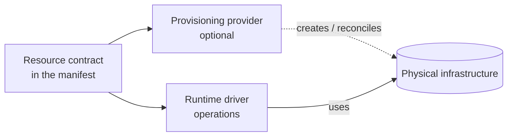

# Infrastructure providers

> **Status:** Partly implemented. Capability checks (`checkCapabilities`, `bindApp`), the runtime driver and source contracts in `@holqa/core`, and the first binding, the local one in `@holqa/local`, are **Implemented** ([ADR 0024](../architecture/decisions/0024-event-delivery-sources-and-local-drivers.md), [local environment](../reference/local.md)). Provisioning providers and bindings for external services are not implemented. The three-part split (contract, runtime driver, provisioning provider) stays **Proposed** in [ADR 0005](../architecture/decisions/0005-infrastructure-independent-resource-contracts.md) until at least one external provider validates it.

Holqa is infrastructure-agnostic: applications declare **logical** resources, and the same application can run against a local environment, self-managed infrastructure, or third-party services. This page explains how logical requirements are connected to real infrastructure, and why portability is never allowed to hide semantic differences.

## Three responsibilities

| Responsibility | What it does | Needs provisioning permissions? |
| --- | --- | --- |
| **Resource contract** | Provider-independent description of a resource: its schema, operations, and required guarantees. Lives in the application's declarations and the manifest. | No |
| **Runtime driver** | Performs resource operations at runtime: sends and receives queue messages, reads and writes objects, fires scheduled invocations. | **No.** Only the data-plane permissions it needs. |
| **Provisioning provider** (optional) | Creates, updates, and reconciles physical infrastructure to satisfy the contract. | Yes, and only when explicitly run. |

The separation matters:

- **A runtime driver must not automatically require provisioning permissions.** An application that sends queue messages needs permission to send, not to create or delete queues. This follows least privilege and limits the damage of a compromised runtime.
- **Provisioning is optional.** Teams that manage infrastructure with existing tools (or reuse existing resources) can bind a runtime driver to infrastructure that Holqa did not create.
- **Contracts never change based on the provider.** The same `infra.ts` describes the same requirements everywhere.

## Bindings

A **binding** associates a logical resource with a runtime driver (and optionally a provisioning provider) in a particular environment. Bindings are **environment-specific** where appropriate:

| Environment | `order-processing` queue bound to | `customer-uploads` bucket bound to |
| --- | --- | --- |
| Local development | Local queue emulator | Filesystem-backed storage emulator |
| Tests | Deterministic in-memory driver | In-memory driver |
| Staging | Self-hosted broker driver | S3-compatible storage driver |
| Production | A managed queue driver | S3-compatible storage driver |

The table above is illustrative; only the local drivers in `@holqa/local` exist. Where bindings are declared (a separate file, CLI configuration, or environment configuration) is **Proposed**. They do not live inside resource declarations.

## No provider configuration bags in core

The core resource model must not contain arbitrary provider-specific configuration bags such as `queue({ ..., providerOptions: { visibilityTimeoutSeconds: 30 } })`.

Instead:

1. A logical resource declares the **behavior it requires** (for example: dead-letter support, at-least-once delivery, maximum message size).
2. The selected binding declares the **capabilities it provides**.
3. Holqa verifies that the capabilities satisfy the requirements.

Provider-specific tuning belongs in the binding, which is outside the portable application definition. This keeps `infra.ts` portable and prevents the core model from slowly turning into a superset of every vendor's API.

## Capability negotiation

Capability negotiation is how a binding proves it can satisfy a contract. The following table is illustrative of the kinds of capabilities involved; the actual capability vocabulary is **Proposed**.

| Capability | Requirement source (example) | Local emulator | Driver A (illustrative) | Driver B (illustrative) |
| --- | --- | --- | --- | --- |
| `queue.delivery.atLeastOnce` | Every queue | Yes | Yes | Yes |
| `queue.deadLetter` | `delivery.deadLetter: true` | Yes | Yes | No |
| `queue.delay` | Delayed `send` | Yes | Yes | Yes |
| `queue.ordering.fifo` | A future ordering requirement | No | Yes | No |
| `queue.maxMessageBytes` | Message size limit | Configurable | 256 KiB | 512 MiB |
| `storage.events.objectCreated` | A bucket event handler | Yes | Yes | Yes |
| `storage.signedUrls` | Signed URL operations | Yes | Yes | No |
| `schedule.timezone` | `timezone` other than UTC | Yes | Yes | UTC only |

Negotiation outcomes:

| Outcome | Behavior |
| --- | --- |
| All requirements satisfied | Binding accepted. |
| A requirement is unsatisfied | **Explicit failure** with a diagnostic naming the resource, the requirement, and the binding. |
| A capability is stronger than required | Accepted. Application code must still not depend on the stronger guarantee. |

### Explicit failure on unsupported semantics

Provider independence does not imply that every provider offers identical functionality or guarantees. An unsupported capability **fails explicitly**; it is never silently ignored or emulated with weaker semantics. For example, if a queue declares `deadLetter: true` and the bound driver cannot dead-letter, Holqa must refuse the binding rather than drop messages after the final attempt.

When this check runs (at `holqa build`, `holqa doctor`, deployment time, or all three) is **Proposed**. The compiler already records the capabilities an application requires in the manifest (`requiredCapabilities`, **Implemented**, with the vocabulary in the [compiler specification](../reference/compiler-specification.md#required-capabilities)); comparing them with a binding at build time is **Planned**.

## Possible future adapters

Potential future runtime drivers and providers include cloud queue services, S3-compatible object storage, RabbitMQ, Redis, and others. None are implemented, and the project deliberately avoids centering any single cloud vendor. The first drivers will be chosen to validate the abstraction (see Phase 5 of the [roadmap](../roadmap.md)).

Drivers and providers depend inward on `@holqa/core` contracts; core never depends on them ([package boundaries](../architecture/package-boundaries.md)).

## The local provider

A local provider is particularly important. Every Holqa application should be runnable **without cloud credentials**:

- Local emulators implement the same runtime driver contract as production drivers.
- They declare their capabilities honestly, including where they are weaker or different.
- They must not falsely guarantee stronger delivery or concurrency semantics than production drivers are expected to provide, so that code that works locally does not depend on local-only behavior.

`@holqa/local` implements this provider's runtime half for queues, buckets and schedules; its advertised capabilities and semantic differences are listed in the [local environment reference](../reference/local.md). See [local development](local-development.md).

## Provisioning safety

Provisioning providers reconcile physical infrastructure, which makes them the most dangerous component. Design rules:

- Deleting a declaration never implies deleting physical infrastructure ([application model](application-model.md#resource-lifecycles)).
- Provisioning produces a reviewable plan before applying changes.
- Destructive actions (deleting queues, buckets, or data) require explicit confirmation and are never performed silently, including by agents.
- Provisioning credentials are separate from runtime credentials.

See [security](security.md).

## Related

- [Resource graph](resource-graph.md#three-separated-concerns)
- [Triggers and execution](triggers-and-execution.md)
- [Local development](local-development.md)
- [ADR 0005: Infrastructure-independent resource contracts](../architecture/decisions/0005-infrastructure-independent-resource-contracts.md)
