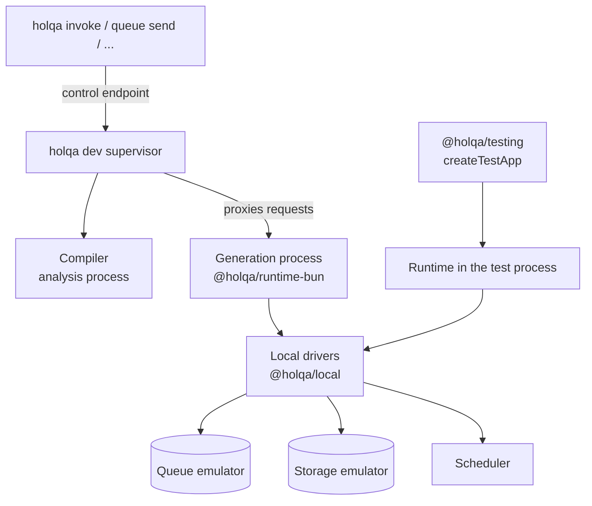

# Local development

> **Status:** **Implemented** for the local drivers (`@holqa/local`), the Bun runtime (`@holqa/runtime-bun`), the development supervisor `holqa dev` with reload by process restart and hot handler replacement, the local development dashboard, the operation commands (`holqa invoke`, `queue send`, `queue redrive`, `storage put`, `cron run`, `state`, `doctor`) and `createTestApp` in `@holqa/testing` with recording and replay. Module unloading, worker isolation, type checking during reload and the Vite integration are **Planned**. All packages are private and unpublished. See Phase 3 and M10 of the [roadmap](../roadmap.md).

Local development is central to Holqa. A developer should be able to clone an application and run it, including its queues, storage, and schedules, without cloud credentials, Docker, or several terminal processes. This page describes the local environment, what exists of it today, and the constraints it must respect. For a step-by-step walkthrough, see the [local development guide](../guides/local-development.md); for every command and its JSON output, see the [CLI reference](../reference/cli.md).

## Goals

| Capability | Description | Status |
| --- | --- | --- |
| Bun-based function execution | Handlers run in Bun, the same runtime as production ([ADR 0002](../architecture/decisions/0002-bun-as-primary-runtime.md)). | **Implemented** |
| HTTP and RPC routing | A local server for declared APIs and RPC procedures (`@holqa/runtime-bun`). | **Implemented** |
| Local queue emulation | SQLite-backed queue with leases, delays, retries, backoff, and dead-lettering (`@holqa/local`). | **Implemented** |
| Object storage emulation | Filesystem-backed storage that emits object-created and object-deleted events and serves development signed URLs. | **Implemented** |
| Local scheduler | Fires schedule handlers according to cron, timezone, and overlap policy, driven by an injectable clock. | **Implemented** |
| Development supervisor | `holqa dev` analyzes the application, writes its build, starts a generation process with the local drivers, serves it at a stable address, and reports resources, handlers, endpoints, errors and logs. | **Implemented** |
| CLI operations | `holqa invoke`, `queue send`, `storage put` and `cron run` run in the running dev session, or in a process started for the command; every command supports `--json` and stable exit codes. | **Implemented** |
| Local state inspection | `holqa state` lists queue messages with their states and attempts, stored objects, object events with their deliveries, and schedule runs. The same data is available as an API (`queues`, `storage`, `scheduler`). | **Implemented** |
| Structured logs and trace correlation | JSON log entries with `correlationId`, `invocationId`, `causationId`, `traceId`, trigger kind, delivery attempt, emitted messages and objects, and the failing handler's source. | **Implemented** |
| Local execution history | Spans, logs and metrics in the local telemetry store; `holqa logs`, `traces list`, `traces inspect`, `events inspect` and `metrics`; OTLP export when `OTEL_EXPORTER_OTLP_ENDPOINT` is set ([observability](observability.md)). | **Implemented**; graphical timeline view **Planned** |
| Backend reloads | Changed files are classified. Handler-only changes replace handlers in the running generation process; everything else restarts it in two phases. Local state survives both. | **Implemented** (hot handler replacement and process restart); module unloading **Planned** |
| Development dashboard | A read-only page at `/_holqa/dashboard` showing handlers and their versions, resources, queue backlog, dead letters, schedules, reloads, build diagnostics, recent logs and traces. | **Implemented** |
| Deterministic integration testing | `createTestApp` in `@holqa/testing`: isolated local state, a virtual clock, event flushing, failure injection, duplicate delivery, inspection, recording and replay of handler inputs, stepping through causal chains, and disposal. | **Implemented** |
| Failure simulation | Duplicate deliveries, injected handler failures, retries, dead letters and redrive. | **Implemented** |
| Diagnostics | `holqa doctor` checks Bun, the application, its configuration and capabilities, the local state, the dev session and the dev port. | **Implemented** |
| Vite frontend HMR | Reuse Vite's dev server and HMR for the frontend. | **Planned** |
| Single-origin development | Frontend and backend served from one origin. | **Planned** |

## Commands

| Command | Behavior |
| --- | --- |
| `holqa dev` | Run the application locally with the local drivers, and rebuild when files change. |
| `holqa invoke <handler>` | Invoke a queue, object event or schedule handler once with a test input. |
| `holqa queue send <queue>` | Send a validated message to a local queue. |
| `holqa queue redrive <queue>` | Redrive (or, with `--dry-run`, list) dead-lettered messages; `--new-operation` gives each a fresh lineage. See [event safety](event-safety.md#replay). |
| `holqa storage put <bucket> <file>` | Upload a file to a local bucket, which emits `object.created`. |
| `holqa cron run <schedule>` | Run a schedule's handler now, recorded as a manual run. |
| `holqa state` | Print local queue messages, objects, events and schedule runs. |
| `holqa doctor` | Check the project, its configuration and the local environment. |
| `holqa inspect` | Print the application's resources, handlers, configuration and graph. |

When `holqa dev` is running for the application, the operation commands send their work to it over an authenticated local endpoint, so invocations appear in the session's logs and share its process. Otherwise they analyze the application and start a process for the one operation. `holqa openapi generate` is the only listed command that is still **proposed**; it exits with `HOLQA_CLI_NOT_IMPLEMENTED`.

## Architecture

- The supervisor owns the stable HTTP address and the session file (`.holqa/dev/session.json`, readable by its owner only). It never runs application code itself.
- Each generation is a separate Bun process that loads the build, creates a runtime and a local environment on the shared state directory, and serves on a loopback port the supervisor forwards to.
- `@holqa/local` implements the runtime driver and source contracts for each resource kind, the same contracts production drivers implement ([infrastructure providers](infrastructure-providers.md)). `@holqa/runtime-bun` executes handlers and does not depend on `@holqa/local` ([package boundaries](../architecture/package-boundaries.md)).
- The Vite integration is **Planned**.

## Backend reloads

Reloads favor correctness over speed. The design is recorded in [ADR 0025](../architecture/decisions/0025-dev-supervisor-and-process-generations.md).

| Change | Classification | What happens |
| --- | --- | --- |
| First build | `initial` | The application is analyzed and the first generation starts. |
| Handler code, or code it imports, with an unchanged manifest | `implementation` | The changed handlers are replaced in the running generation when the change qualifies for hot replacement (see below); otherwise the generation restarts. The resource graph and contracts are unchanged. |
| Only `.env` files in the application root | `environment` | The generation restarts without re-analysis, so it reads the new values. |
| Handlers added, removed, or with new triggers or contracts | `handlers` | The generation restarts; the change is reported per handler. |
| Resources or configuration entries | `resources` | The generation restarts; added, removed and changed resources are reported. The state of removed resources is kept. |

- A reload starts the new generation in two phases. In the first, the new process loads every module, creates its runtime and checks configuration and capabilities while the previous generation keeps serving. A failure there reports `HOLQA_RELOAD_FAILED` with its causes, and the previous generation keeps running. Only then is the previous generation stopped gracefully, and the new one starts consuming and serving.
- Exactly one generation consumes queues, object events and schedules at a time, so restarts never duplicate consumers. Each restart starts a fresh process, so module state, listeners and timers of the old code cannot leak across a restart. Subscriptions of object event handlers that no longer exist are removed when a generation starts.
- Requests that arrive during a swap wait for the new generation instead of failing.
- Local state (queued messages, stored objects, events, schedule history) lives in the state directory and survives every reload.
- When a contract changes (a queue message, a request or a response schema), the compatibility checker's diagnostics are reported, for example `HOLQA_SCHEMA_CHANGE_BREAKING`. Contract errors that the compiler rejects fail the reload.

### Hot handler replacement

When a change leaves the manifest and the entry point map unchanged and only touches handler modules, or modules that only handler modules import, `holqa dev` replaces the affected handlers in the running generation process instead of restarting it. The affected handler modules are rebundled; the application module, its imports, packages and files outside the application root stay shared with the running code. A rebundled module that creates timers, listeners, servers or new globals while it loads is not swapped. The new implementations are installed atomically as a new handler version: invocations that already started finish on the old implementation, new ones run the new code, and a replaced version is retired when its last invocation finishes. The design is recorded in [ADR 0028](../architecture/decisions/0028-hot-handler-replacement.md).

- Every other change falls back to the process restart above, which keeps local state: the application module or its imports, resources, configuration, handler definitions or contracts, `.env` files, dependency or `tsconfig` files, files no handler references, modules marked with a `holqa:restart-on-change` comment, detected module-level side effects, and every change after 50 replacements in one process. `--no-hot` turns hot replacement off.
- A change that fails to build or load keeps the last working code serving, and the session is reported as stale until a later change succeeds.
- Queue consumers are never registered again, so there is still one consumer per queue. When a queue's contract changes, messages already waiting are checked against the new contract and reported as `HOLQA_QUEUED_MESSAGE_INCOMPATIBLE` warnings; they are not changed.
- Old module copies stay in memory until the process restarts (module unloading is **Planned**), and `holqa dev` does not type-check during reload. Worker isolation and a Vite module runner integration are **Planned**.

### Development dashboard

`holqa dev` serves a read-only dashboard at `/_holqa/dashboard` when it listens on a loopback address; `--no-dashboard` turns it off. It presents the supervisor status, the local state, the session logs and the local telemetry store: handlers with their versions, resources, queue backlog and dead letters, schedules, reload history and stale state, build diagnostics, recent logs and invocations with their causal fields, and traces. It never shows message payloads and cannot change state. See the [local development guide](../guides/local-development.md).

## Simulating failure

Code that only runs on the happy path locally will fail in production. The local environment makes failure behavior testable; the [order pipeline example](../../examples/order-pipeline/README.md) and the [document-processing example](../../examples/document-processing/README.md) exercise retries and dead-lettering end to end:

| Scenario | Purpose | How |
| --- | --- | --- |
| Duplicate delivery | Verify that queue consumers and event handlers are idempotent. | `TestApp.duplicate`, `duplicateEvent`; `queues.duplicate` |
| Forced handler failure and retry | Verify retry and backoff configuration. | `TestApp.failNext`, then `advance` or `drain` |
| Exhausted retries | Verify dead-letter behavior. | `failNext({ times })`, `deadLetters`, `redrive` |
| Out-of-order storage events | Verify handlers do not assume ordering. | Events have no guaranteed order |
| Overlapping schedule runs | Verify the overlap policy. | `ManualClock.jump`, `trigger` |
| Invalid message payloads | Verify runtime validation at the boundary. | `holqa queue send` and `TestApp.send` validate like producers |

Tests are deterministic: a test controls when messages are delivered and when schedules fire, rather than waiting on wall-clock time. `createTestApp` moves a virtual clock to each due retry or schedule and runs the work that becomes due, so a workflow test never sleeps for a real retry interval.

## Semantics: no over-promising

The local environment must **not** falsely guarantee stronger delivery or concurrency semantics than production drivers provide. If the local queue delivered every message exactly once and in order, applications would pass locally and fail in production.

- Local drivers declare their capabilities honestly ([capability negotiation](infrastructure-providers.md#capability-negotiation)).
- At-least-once delivery means duplicates are possible locally, and the environment makes them easy to trigger.
- Concurrency limits are enforced locally as declared, so race conditions surface during development.
- Where local behavior is necessarily different (for example, no network partitions), the difference is documented in the [local environment reference](../reference/local.md).

## Related

- [Local development guide](../guides/local-development.md)
- [CLI reference](../reference/cli.md)
- [Local environment reference](../reference/local.md)
- [Triggers and execution](triggers-and-execution.md)
- [Infrastructure providers](infrastructure-providers.md)
- [Vite](../integrations/vite.md)
- [Testing (contributing)](../contributing/testing.md)
