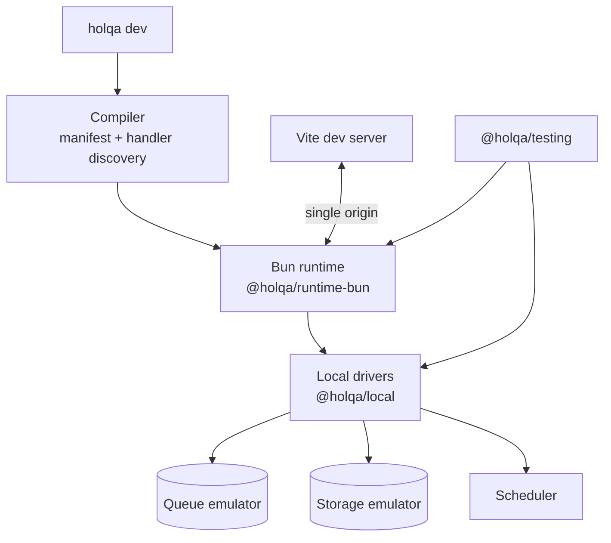

# Local development

> **Status:** Planned — not implemented. `holqa dev` and every other workflow command are proposed; today the CLI reports `HOLQA_CLI_NOT_IMPLEMENTED` for them. See Phase 3 of the [roadmap](../roadmap.md).

Local development is central to Holqa. A developer should be able to clone an application and run it, including its queues, storage, and schedules, without cloud credentials. This page describes the planned local environment and the constraints it must respect.

## Goals

| Capability | Description |
| --- | --- |
| Bun-based function execution | Handlers run in Bun, the same runtime as production ([ADR 0002](../architecture/decisions/0002-bun-as-primary-runtime.md)). |
| HTTP and RPC routing | A local server for declared APIs and RPC procedures. |
| Local queue emulation | In-process or lightweight queue with retries, backoff, and dead-lettering. |
| Object storage emulation | Filesystem-backed or otherwise lightweight storage that emits object-created and object-deleted events. |
| Local scheduler | Fires schedule handlers according to cron, timezone, and overlap policy. |
| Event inspection | View messages, storage events, schedule runs, and handler outcomes. |
| Structured logs and diagnostics | Machine-readable logs and `HOLQA_*` diagnostics. |
| Deterministic integration testing | Drive events and assert outcomes in tests (`@holqa/testing`). |
| Fast backend reloads | Reload changed handlers without restarting the whole environment. |
| Vite frontend HMR | Reuse Vite's dev server and HMR for the frontend. |
| Single-origin development | Frontend and backend served from one origin where possible. |
| Failure simulation | Duplicate deliveries, retries, and handler failures on demand. |

## Planned commands

The following commands are **proposed and not implemented**. Running any of them today exits with code `1` and a `HOLQA_CLI_NOT_IMPLEMENTED` diagnostic.

| Command | Intended behavior |
| --- | --- |
| `holqa dev` | Run the application locally with emulated resources. |
| `holqa invoke` | Invoke a handler locally with a test event. |
| `holqa queue send` | Send a message to a local queue. |
| `holqa storage put` | Upload an object to local storage. |
| `holqa cron run` | Trigger a scheduled task immediately. |
| `holqa inspect` | Print the application resource graph. |

See the [CLI reference](../reference/cli.md).

## Architecture

- `@holqa/local` implements the runtime driver contract for each resource kind, the same contract production drivers implement ([infrastructure providers](infrastructure-providers.md)).
- `@holqa/runtime-bun` executes handlers. `@holqa/local` depends on it; it does not depend on `@holqa/local` ([package boundaries](../architecture/package-boundaries.md)).
- The CLI composes the compiler, runtime, and local drivers.

## Frontend development with Vite

Holqa should not build another frontend development server. The plan is to reuse Vite's existing dev server and HMR machinery:

- A Vite plugin or middleware integration routes API and RPC requests to the Holqa runtime, so the frontend and backend share one origin and cookies, CORS, and relative URLs behave as in production.
- Vite keeps ownership of frontend module graphs, HMR, and static builds.
- Static site resources (`staticSite`) use the Vite build output in production.

See [Vite](../integrations/vite.md).

## Backend reloads

Fast backend reloads are planned, with correctness taking priority over speed:

- When a handler module changes, the runtime should invalidate that module and its dependents, and swap the handler without restarting the whole environment.
- Stale resources (timers, open connections, in-flight consumers belonging to the old module) must be cleaned up.
- When `infra.ts` changes, the resource graph is recompiled. Emulated resource state (queued messages, stored objects) should survive reloads, because persistent resource lifecycles are independent of handlers ([application model](application-model.md#resource-lifecycles)).
- Where safe invalidation cannot be guaranteed, a full restart is the correct fallback.

## Simulating failure

Code that only runs on the happy path locally will fail in production. The local environment and `@holqa/testing` are designed to make failure behavior testable:

| Scenario | Purpose |
| --- | --- |
| Duplicate delivery | Verify that queue consumers are idempotent. |
| Forced handler failure and retry | Verify retry and backoff configuration. |
| Exhausted retries | Verify dead-letter behavior. |
| Out-of-order storage events | Verify handlers do not assume ordering. |
| Overlapping schedule runs | Verify the overlap policy. |
| Invalid message payloads | Verify runtime validation at the boundary. |

Tests should be deterministic: a test controls when messages are delivered and when schedules fire, rather than waiting on wall-clock time.

## Semantics: no over-promising

The local environment must **not** falsely guarantee stronger delivery or concurrency semantics than production drivers provide. If the local queue delivered every message exactly once and in order, applications would pass locally and fail in production.

Design rules:

- Local drivers declare their capabilities honestly ([capability negotiation](infrastructure-providers.md#capability-negotiation)).
- At-least-once delivery means duplicates are possible locally, and the environment should make them easy to trigger.
- Concurrency limits are enforced locally as declared, so race conditions surface during development.
- Where local behavior is necessarily different (for example, no network partitions), the difference is documented.

## Related

- [Triggers and execution](triggers-and-execution.md)
- [Infrastructure providers](infrastructure-providers.md)
- [Vite](../integrations/vite.md)
- [Testing (contributing)](../contributing/testing.md)
