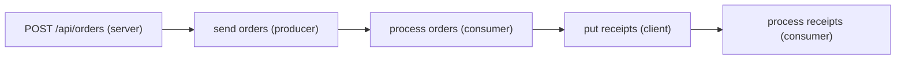

# Observability

> **Status:** **Implemented** for structured logging with redaction, distributed tracing with W3C trace context, framework metrics, OTLP/HTTP export (`@holqa/opentelemetry`), the local telemetry store and the telemetry commands of the CLI, and in-memory telemetry for tests, in the private, unpublished packages. A graphical trace timeline view, an `@opentelemetry/api` bridge and OTLP over protobuf or gRPC are **Planned**. See [ADR 0027](../architecture/decisions/0027-observability-telemetry-and-local-inspection.md).

Holqa observes every execution the same way, whatever triggered it: HTTP routes, RPC procedures, queue messages, object events and scheduled runs all run through one dispatcher, which writes structured logs, records spans and updates metrics. Telemetry follows the OpenTelemetry data model and W3C Trace Context, so it can be sent to any backend that accepts OTLP. No monitoring provider is required, and local development needs no hosted account.

| Signal | Where it goes | Default |
| --- | --- | --- |
| Structured logs | The runtime's log sink (JSON lines on standard output by default) | Always on |
| Traces | Telemetry exporters | Recorded when exporters are configured or `telemetry.enabled` is `true` |
| Metrics | Telemetry exporters | Same as traces |
| Log records | Telemetry exporters, as OpenTelemetry log records | Off; `telemetry.exportLogs` turns it on |

`holqa dev` and the operation commands (`invoke`, `cron run`) always record telemetry in the local telemetry store, and also export over OTLP/HTTP when `OTEL_EXPORTER_OTLP_ENDPOINT` is set. See the [observability guide](../guides/observability.md).

## Structured logging

Handlers log through the invocation context:

```ts
export default resources.orders.consume({
  id: "orders.process",
  handler: async ({ message, log }) => {
    log.info("Processing order", { orderId: message.orderId });
  }
});
```

`log` has `debug`, `info`, `warn` and `error`. Every entry carries, without the handler passing them:

| Field | Meaning |
| --- | --- |
| `application` | The application's name. |
| `handlerId`, `invocationId` | Which handler, which execution. |
| `correlationId` | Groups every invocation of one business operation. |
| `causationId`, `rootId`, `depth` | The [event lineage](event-safety.md#event-lineage), for invocations caused by an event. |
| `traceId`, `spanId` | The invocation's span, when telemetry is recorded. |
| `triggerKind`, `resourceId` | What triggered the invocation. |
| `method`, `path` / `deliveryId`, `attempt` / `runId` | Transport details for HTTP, deliveries and scheduled runs. |

- **Levels.** `createRuntime({ logLevel })` drops entries below `debug`, `info`, `warn` or `error`. The default, `debug`, writes every entry.
- **Transports.** `createRuntime({ log })` takes any sink, a function that receives each entry. `jsonLineSink` writes JSON lines; `silentSink` drops everything. `holqa dev` stores entries in the local telemetry store and prints them.
- **Redaction.** See [privacy](#privacy-and-redaction).
- **Standard logging keeps working.** Holqa does not intercept or replace `console` calls. Their output is not structured, not correlated and not redacted.

## Tracing

The runtime starts a span for every invocation and for every resource operation handler code performs:

| Span | Kind | Example name |
| --- | --- | --- |
| HTTP route or RPC procedure | `server` | `GET /api/orders/:orderId` (method and route template; the method alone when no route matched; `HTTP` instead of an unknown method) |
| Queue message processing | `consumer` | `process orders` |
| Object event processing | `consumer` | `process receipts` |
| Scheduled run | `internal` | `run cleanup` |
| Direct invocation (`runtime.invoke`, `holqa invoke`) | `internal` | `invoke orders.process` |
| Queue send from handler code | `producer` | `send orders` |
| Storage operation from handler code | `client` | `put receipts`, `get`, `head`, `list`, `delete`, `sign` |

A typical trace of an order:



### Propagation

- **HTTP.** A request's `traceparent` (and `tracestate`) header is continued unless `telemetry.acceptTraceparent` is `false`. A continued trace follows the caller's sampling flag, so a caller can force its requests to be recorded; set `false` for untrusted callers.
- **Messages and object events.** When handler code sends a message or writes or deletes an object, the producer or client span's context is stored with the delivery as `DeliveryTrace.traceparent`, next to its lineage. Bindings that cannot store it only lose trace correlation. The local binding stores it (state format 4).
- **Messaging relationship.** By default a processing span is a child of the span that published the message and also records a span link to it, so one request and everything it caused form one trace. `telemetry.messages: "link"` starts a new trace for each delivery with only the link, as OpenTelemetry's messaging conventions recommend for batched or long-delayed processing. Each retry is its own processing span with `holqa.delivery.attempt`.
- **Handlers.** Handler and middleware arguments include an optional `telemetry` (`traceId`, `spanId`, `sampled`, `traceparent`) to propagate to outgoing calls.

### Lineage is independent of tracing

Trace identifiers may come from callers and are sampled; lineage roots are assigned by the runtime and always stored. Sampling never changes lineage, depth limits or operation budgets, and an unsampled trace does not disable any safety control.

### Span attributes and status

Invocation spans carry `holqa.handler.id`, `holqa.invocation.id`, `holqa.correlation.id`, `holqa.lineage.root_id`, `holqa.lineage.depth`, `holqa.lineage.causation_id`, `holqa.trigger.kind`, `holqa.resource.id`, `holqa.outcome`, `error.type` (the diagnostic code of a failure) and `holqa.event_guard.code` when an event guard refused a publication. HTTP spans follow OpenTelemetry's HTTP conventions (`http.request.method`, `http.route` once a route matched, `http.response.status_code`). The request path is not recorded, because paths may hold identifiers or personal data. A method outside `GET`, `HEAD`, `POST`, `PUT`, `PATCH`, `DELETE`, `OPTIONS`, `CONNECT` and `TRACE` is recorded as `_OTHER`, with the original (at most 32 characters) in `http.request.method_original` on the span only; metrics never carry it. (Bun itself turns some non-standard methods, such as `BREW`, into `GET` before the runtime sees them.) messaging spans its messaging conventions (`messaging.system: "holqa"`, `messaging.destination.name`, `messaging.operation.type`, `messaging.message.id`). Failures record an `exception` event with the error's type, message and stack.

- An HTTP `4xx` is the caller's error and does not set an error status on the server span; a `5xx` does.
- Object keys are not recorded in span attributes, because keys may hold personal data; storage spans record the bucket, the operation and the size of written objects.
- A streaming response's span ends when the `Response` is created, not when its body finishes.

## Metrics

The runtime reports a fixed set of framework metrics, defined in `frameworkMetrics` of `@holqa/core`:

| Metric | Type | Unit | Attributes |
| --- | --- | --- | --- |
| `holqa.handler.invocations` | counter | `{invocation}` | `holqa.handler.id`, `holqa.trigger.kind`, `holqa.outcome` |
| `holqa.handler.duration` | histogram | `s` | `holqa.handler.id`, `holqa.trigger.kind`, `holqa.outcome` |
| `holqa.handler.failures` | counter | `{invocation}` | `holqa.handler.id`, `holqa.trigger.kind`, `error.type` |
| `holqa.invocations.active` | gauge | `{invocation}` | `holqa.invocation.state` (`running`, `waiting`) |
| `holqa.queue.pending` | gauge | `{message}` | `messaging.destination.name` |
| `messaging.process.duration` | histogram | `s` | `messaging.destination.name`, `messaging.operation.name`, `holqa.outcome` |
| `holqa.delivery.retries` | counter | `{delivery}` | `holqa.handler.id`, `messaging.destination.name` |
| `holqa.delivery.dead_letters` | counter | `{delivery}` | `holqa.handler.id`, `messaging.destination.name`, `holqa.settlement` |
| `holqa.events.blocked` | counter | `{event}` | `holqa.handler.id`, `error.type` |
| `http.server.request.duration` | histogram | `s` | `http.request.method`, `http.route`, `http.response.status_code` |
| `holqa.dev.reload.failures` | counter | `{reload}` | `holqa.reload.stage` (`build`, `start`) |
| `holqa.telemetry.dropped` | counter | `{record}` | `holqa.telemetry.signal`, `holqa.telemetry.reason` |

- **Cardinality.** Each metric accepts only its listed attribute keys; anything else (user, message, invocation or object identifiers, object keys, payload fields) is dropped before aggregation. Each metric tracks at most 2 000 attribute combinations (`telemetry.limits.maxSeriesPerMetric`); further combinations are aggregated into one series with `otel.metric.overflow: true`.
- **Temporality.** Sums and histograms are cumulative since the runtime started. Histograms use explicit buckets (OpenTelemetry's advisory duration buckets, 5 ms to 10 s).
- `holqa.queue.pending` is reported only for queues whose binding implements `QueueSource.pending`, as the local binding does.
- `holqa.dev.reload.failures` is counted by the `holqa dev` session in the local telemetry store, not by a runtime.

## Exporters and backends

| Exporter | Package | What it does |
| --- | --- | --- |
| OTLP/HTTP | `@holqa/opentelemetry` | Posts OTLP/JSON to any OTLP/HTTP receiver: an OpenTelemetry Collector (which can forward to Jaeger, Grafana-based stacks and other backends), or a backend that accepts OTLP directly. |
| Local store | `@holqa/local` | Keeps recent spans, logs and metrics in `telemetry.sqlite` for the CLI. |
| Memory | `@holqa/testing` | Keeps everything in memory for assertions. |

Exporters are optional and any number can be combined. Holqa does not provide a production log database or trace backend. The `TelemetryExporter` interface in `@holqa/core` lets other exporters be written without depending on OpenTelemetry packages.

## Local execution history

The local telemetry store in the state directory (default `.holqa/local/telemetry.sqlite`) keeps at most 20 000 spans and 20 000 log entries, and nothing older than 24 hours (checked every 200 writes). It is a development aid and may be deleted at any time. The CLI reads it:

| Command | Shows |
| --- | --- |
| `holqa logs [--follow]` | Recent log entries, filtered by handler, trace or level. |
| `holqa traces list` | Recent traces with duration, span count and errors. |
| `holqa traces inspect <trace-id>` | One trace as a tree of spans with a timeline, exceptions and links. |
| `holqa events inspect <event-id>` | A queue message's or object event's deliveries, lineage, last error, invocations, logs and spans. |
| `holqa metrics` | The framework metrics, with histogram summaries. |

See the [CLI reference](../reference/cli.md#telemetry-commands).

## Failure policy

Telemetry never affects invocations:

- Spans and log records wait in bounded buffers (2 048 each by default). A full buffer drops the newest records and counts them in `holqa.telemetry.dropped`.
- Buffers are exported every second or, on a later turn of the event loop, when 512 records are waiting; recording never calls an exporter. Metrics are collected every 10 seconds; gauges are also limited to the series limit, and a gauge whose source fails is skipped and reported like an export failure with exporter `meter`. One export per signal runs at a time, and each export call has a 10-second limit. All are configurable in `telemetry.limits`.
- An exporter that rejects or times out loses that batch; other exporters still receive it. The runtime logs `telemetry export failed; the records were dropped` with `HOLQA_TELEMETRY_EXPORT_FAILED` at most once per minute per exporter and signal.
- The OTLP exporter does not retry, so an unavailable receiver costs one bounded request per export interval.
- Exporters receive an `AbortSignal` that aborts when their export time limit passes, and should work asynchronously: a method that blocks before its first `await` blocks the event loop.
- Timers, including export time limits, do not keep the process alive. `runtime.stop` flushes and shuts exporters down within `telemetryMs` (default 5 seconds).
- Invalid settings (unknown `telemetry` keys, non-boolean flags, invalid `ids` or `resource`, out-of-range values) are rejected at `createRuntime` with `HOLQA_TELEMETRY_CONFIG_INVALID`. Identifiers a custom generator returns that are not valid are replaced with random ones.

## Privacy and redaction

Before an entry reaches a sink or a span reaches an exporter:

- Values of fields whose names, lowercased and stripped of everything but letters and digits, contain `password`, `passwd`, `secret`, `privatekey` or `credential` anywhere, or end with `token`, `authorization`, `cookie`, `apikey`, `accesskey` or `signature`, become `[REDACTED]`: `dbPassword`, `accessToken` and `x-api-key` are redacted, `tokenCount`, `maxTokens` and `signatureAlgorithm` are not. Names added with `createRuntime({ redact: { keys } })` match anywhere. Only the message and fields of a log entry are redacted, never `level` or `time`.
- Every occurrence of a declared secret's value (read from the binding when the runtime starts) in messages, fields, span attributes, exception messages and stacks becomes `[REDACTED]`. Values shorter than four characters are not searched for.
- Redaction cannot recognize secrets it was not told about, or secrets that were transformed (encoded, hashed, split). Keep such data out of logs.
- Request and response bodies are never logged or recorded. OTLP header values (often credentials) never appear in diagnostics or errors.

## Performance and sampling

- With telemetry disabled, instrumented code only pays for a branch; logs still work.
- `telemetry.sampleRatio` (0 to 1, default 1) samples a new trace when the low 56 bits of its trace identifier, read as a number, are below `ratio × 2^56`, so the decision depends only on the trace identifier; continued traces follow the caller's decision. (`createTestApp` uses small sequential identifiers, which are sampled for any ratio above 0.) Unsampled spans are not recorded, but their context is still propagated, and logs still carry `traceId`.
- Histograms and counters are aggregated in memory; only collections are exported.

## Limitations

- No `@opentelemetry/api` bridge: spans application code creates with the OpenTelemetry API do not join Holqa's traces (**Planned**).
- OTLP over HTTP with JSON only; `grpc` and `http/protobuf` are rejected, not silently replaced. No exporter retries.
- Cumulative temporality only; no exemplars.
- Log records are not exported unless `telemetry.exportLogs` is set, because the OpenTelemetry JavaScript logs signal is still under development.
- Metrics restart with each runtime instance, including each `holqa dev` generation; the local store adds up instances that reported recently.
- The read-only local development dashboard of `holqa dev` (**Implemented**, see [local development](local-development.md)) lists recent logs, invocations and traces from the local telemetry store. A graphical timeline or flame view of traces and event chains is **Planned**.

## Related

- [Observability guide](../guides/observability.md)
- [ADR 0027](../architecture/decisions/0027-observability-telemetry-and-local-inspection.md)
- [Event safety](event-safety.md)
- [Runtime reference](../reference/runtime.md)
- [`@holqa/opentelemetry`](../../packages/integrations/opentelemetry/README.md)
- [Example: observability](../../examples/observability/README.md)
