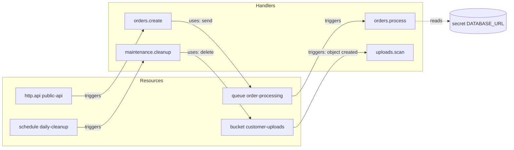

# Resource graph

> **Status:** Implemented in part. The compiler builds the graph from declarations, enforces the graph invariants below and serializes it into manifest version 1 (`holqa inspect`, `holqa build --manifest`); see the [compiler specification](../reference/compiler-specification.md). `uses` and `reads` edges (declared dependencies) are **Proposed**, and checking requirements against a selected binding at build time is **Planned**.

The **application resource graph** is Holqa's central abstraction. It is a single model that connects an application's resources, the triggers they produce, the handlers that respond, and the dependencies between them. Type inference, validation, local emulation, client generation, manifests, and provider bindings are all derived from this graph.

## Elements of the graph

| Element | Description | Example |
| --- | --- | --- |
| **Resource** | A declared logical piece of infrastructure with a stable identifier and a contract. | Queue `order-processing`, bucket `customer-uploads`. |
| **Trigger** | An event source that a resource produces and a handler can respond to. | A queue message, an HTTP request, an object-created event, a cron tick. |
| **Handler** | Application code with its own stable identifier, bound to exactly one trigger. | `orders.process` consuming `order-processing`. |
| **Dependency** | A handler's use of a resource through a typed handle. | An HTTP handler that calls `resources.orders.send(...)`. |
| **Configuration** | Typed secrets and variables that handlers read. | `DATABASE_URL`, `LOG_LEVEL`. |

Edges have a direction and a meaning:

- **triggers**: resource → handler (the resource invokes the handler).
- **uses**: handler → resource (the handler performs operations on the resource).
- **reads**: handler → configuration.

## Example

For the illustrative commerce application in [application model](application-model.md):

From this graph, tooling can answer questions such as:

- Which handlers can put messages on `order-processing`, and which one consumes them?
- What permissions does `maintenance.cleanup` need at runtime? (Delete on `customer-uploads`, nothing else.)
- Which public contracts would a schema change on `order-processing` affect?
- Which secrets must be bound before the application can start in an environment?

## Three separated concerns

The architecture keeps three responsibilities apart. Mixing them is the main way infrastructure frameworks end up coupled to one vendor.

| Concern | Question it answers | Where it lives | Example |
| --- | --- | --- | --- |
| **1. Resource definitions** | What infrastructure exists and what guarantees does it require? | `infra.ts` (declarations), `@holqa/core` (model), `@holqa/sdk` (factories) | "A durable queue whose messages match this schema, retried up to 5 times, with a dead-letter destination." |
| **2. Operations and handlers** | How does application code interact with resources and respond to events? | Handler modules, typed handles | `resources.orders.send(...)`, `resources.orders.consume({ ... })` |
| **3. Infrastructure bindings** | How are the logical requirements fulfilled in a particular environment? | Runtime drivers, provisioning providers, local emulators | A local in-memory queue during development; a self-hosted broker in production. |

Consequences:

- Definitions contain no provider configuration. A queue does not know whether it will be backed by a cloud queue, RabbitMQ, or Redis ([ADR 0005](../architecture/decisions/0005-infrastructure-independent-resource-contracts.md)).
- Handlers depend on operations, not on drivers. The same handler runs against the local emulator, a test harness, and production.
- Bindings are chosen per environment and validated against the definitions' requirements. See [infrastructure providers](infrastructure-providers.md).

## Graph invariants

The compiler (see [compiler](../architecture/compiler.md)) constructs the graph and enforces these invariants with structured diagnostics:

| Invariant | Example violation | Diagnostic | Status |
| --- | --- | --- | --- |
| Identifiers are valid. | `id: "Orders"` | `HOLQA_RESOURCE_ID_INVALID` | **Implemented** |
| Resource identifiers are unique. | Two resources with `id: "web"` | `HOLQA_RESOURCE_ID_DUPLICATE` | **Implemented** |
| Handler identifiers are unique. | Two handlers with `id: "orders.process"` | `HOLQA_HANDLER_ID_DUPLICATE` | **Implemented** |
| References resolve. | A handler for a resource that was removed. | `HOLQA_RESOURCE_NOT_FOUND` | **Implemented** |
| Triggers match their resource. | A queue consumer registered on a bucket, or a consumer whose message contract differs from its queue's. | `HOLQA_TRIGGER_INVALID` | **Implemented** |
| A queue has at most one consumer. | Two `consume` calls on `order-processing`. | `HOLQA_QUEUE_CONSUMER_DUPLICATE` | **Implemented** |
| Routes are unambiguous. | Two handlers for `GET /api/orders/:id`. | `HOLQA_ROUTE_CONFLICT` | **Implemented** in the compiler and in `@holqa/runtime-bun` with one shared rule (`httpRouteKeys`): across every API of the application, including RPC procedure paths |
| Schemas can be normalized. | A schema transformation with no portable form. | `HOLQA_SCHEMA_UNSUPPORTED` | **Implemented** |
| Requirements are satisfiable by the selected binding. | `deadLetter: true` on a driver without dead-letter support. | Not assigned | **Planned** at build time |

See [diagnostic codes](../reference/diagnostic-codes.md) for the naming convention and current registry.

## Graph and manifest

The compiler serializes the graph into a deterministic, versioned, infrastructure-neutral **manifest** (manifest version 1) using canonical JSON. This is **Implemented**; the format is specified in the [compiler specification](../reference/compiler-specification.md#manifest-version-1). The manifest is the hand-off point between the compiler and everything downstream: runtimes, local development, providers, and inspection tools. Because it is canonical JSON, two compilations of the same source produce byte-identical output, and diffs between manifests reflect real changes.

## Dependencies and least privilege

Because every `uses` edge is explicit in the graph, required runtime permissions can be derived per handler rather than granted application-wide. A provider can use this to issue narrowly scoped credentials. This is **Proposed**. Today the graph records only relationships that declarations state (`declares`, `registers`, `requires`, `triggers`, `schema`); it has no `uses` or `reads` edges. Whether handles must be declared up front or can be detected statically is an open design question tied to handler discovery in the compiler.

## Extensibility

Future resource kinds (topics, WebSocket endpoints, workflows, database change streams) fit the same model: a resource with a contract, triggers it can produce, operations it supports, and capability requirements for bindings. Adding a kind should not require changes to existing kinds. See [triggers and execution](triggers-and-execution.md#future-triggers).

## Related

- [Application model](application-model.md)
- [Triggers and execution](triggers-and-execution.md)
- [Compiler](../architecture/compiler.md)
- [Infrastructure providers](infrastructure-providers.md)
