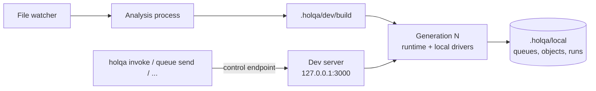

# Local development guide

> **Status:** **Implemented.** `holqa dev` (with hot handler replacement and the development dashboard), the operation commands, `holqa state`, `holqa doctor` and `createTestApp` (with recording and replay) exist in this repository; every package is private and unpublished, so they run inside the workspace. Module unloading, worker isolation and type checking during reloads are **Planned**.

This guide shows how to run a Holqa application on your machine, exercise it, debug it and test it, without infrastructure credentials, Docker or a cloud account. It uses the [order pipeline example](../../examples/order-pipeline/README.md). The commands are specified in the [CLI reference](../reference/cli.md); the design is [ADR 0025](../architecture/decisions/0025-dev-supervisor-and-process-generations.md) and, for reloads that replace handlers in place, [ADR 0028](../architecture/decisions/0028-hot-handler-replacement.md).

## Set up

```bash
git clone <your fork of the Holqa repository> holqa && cd holqa
pnpm install
pnpm build
cd examples/order-pipeline
pnpm start          # runs: holqa dev --app app/infra.ts
```

You need Bun 1.3.13 or later and pnpm. `pnpm exec holqa doctor --app app/infra.ts` checks the Bun version, the application, its configuration, the local binding's capabilities, the local state and the dev port.

## What `holqa dev` does



| Step | What happens |
| --- | --- |
| Analyze | The application module and every handler module are evaluated in an isolated analysis process, as for `holqa inspect`. Compiler errors are reported with locations. |
| Build | The manifest and entry point map are written to `.holqa/dev/build`. |
| Generation | A fresh Bun process loads the build, opens the local state in `.holqa/local` (SQLite queues and events, files for objects, schedule history) and starts one runtime. |
| Serve | The dev server, by default `http://127.0.0.1:3000/`, forwards requests to the current generation and serves local signed URLs. Its address never changes. |
| Report | The banner lists resources, handlers with their endpoints and source modules, and the next schedule runs; then every log entry follows, one line each. |

Everything runs on the local binding. It advertises only what common production services provide (at-least-once delivery, up to 100 attempts, delays up to 900 seconds), so an application that runs locally does not depend on stronger guarantees; see the [local environment reference](../reference/local.md#semantics).

## Exercise the application

With `holqa dev` running, in a second terminal:

```bash
curl -X POST 127.0.0.1:3000/api/orders -H 'content-type: application/json' -d '{"orderId":"123","totalCents":4200}'
curl 127.0.0.1:3000/api/orders/123

pnpm exec holqa invoke orders.process --input '{"orderId":"123"}' --app app/infra.ts
pnpm exec holqa queue send orders --data '{"orderId":"124"}' --app app/infra.ts
pnpm exec holqa storage put uploads ./README.md --app app/infra.ts
pnpm exec holqa cron run cleanup --app app/infra.ts
pnpm exec holqa state --app app/infra.ts
```

Inside the workspace, `pnpm exec holqa` runs the built CLI of packages that depend on `@holqa/cli`, as the example does.

The operation commands find the running session through `.holqa/dev/session.json` and run inside it, so their invocations share the session's runtime and appear in its log. Without a session they start the application for one operation instead: messages and objects are stored and wait for the next `holqa dev`. Every command accepts `--json` and exits with `0` on success, `1` on failure (including a failed handler) and `2` for malformed arguments, so scripts and agents can rely on them.

| Command | Use it to |
| --- | --- |
| `holqa invoke <handler> --input <json>` | Run a queue consumer, object event handler or schedule handler once with a test input. `--attempt 3` shows what a third delivery would see. |
| `holqa queue send <queue> --data <json>` | Send a message, validated against the queue's schema. `--delay 60` delays it. |
| `holqa storage put <bucket> <file>` | Upload a file, which triggers `object.created` handlers. `--key` and `--content-type` override the defaults. |
| `holqa cron run <schedule>` | Run a schedule now, through its overlap policy; the run is recorded in its history. |
| `holqa state` | See queue messages (ready, delayed, in flight, acknowledged, dead-lettered) with attempts and last errors, stored objects, object events per subscription, and schedule runs. |

## How reloads work

Save a file, and `holqa dev` analyzes the application again, compares the result with what runs, and applies the change in one of two ways:

- **Swap.** When only handler code changed, the changed handler modules are rebuilt and their handlers are replaced inside the running process. Local queues, storage, schedules and consumers are not touched. The output says `swapped 3 handlers in generation 1 as version 2 (35 ms)`, and log lines of replaced handlers name their version, for example `orders.process v2`.
- **Restart.** Everything else starts a new generation process in two phases ([ADR 0025](../architecture/decisions/0025-dev-supervisor-and-process-generations.md)), and the build line says why, for example `restarting: The application's resources or configuration changed.` Local state survives restarts too.

| Change | Applied by | Notes |
| --- | --- | --- |
| A handler's code | Swap | The next request or message runs the new code. A request already running finishes under the old code, or at its time limit. |
| A helper module that only handler modules import | Swap | Every handler module that imports it is rebuilt, together with handler modules that share any module with them, so module state stays shared as before. |
| The application module (`infra.ts`) or any module it imports | Restart | Resources are evaluated once per process. |
| A handler added, removed, moved, or its trigger or schemas changed | Restart | New handlers start receiving; removed object event handlers stop collecting events. |
| A resource or configuration entry added, removed or changed | Restart | The new graph is served. A removed resource's local state is kept, never deleted. |
| A queue message or HTTP request or response schema | Restart | The compatibility checker reports breaking changes (`HOLQA_SCHEMA_CHANGE_BREAKING`), and messages already waiting in a changed queue are checked against the new contract (`HOLQA_QUEUED_MESSAGE_INCOMPATIBLE` lists them). Increase `schemaVersion` for breaking message changes. |
| Only `.env` files | Restart | Without re-analysis. |
| `package.json`, lockfiles, `tsconfig*.json`, `bunfig.toml` | Restart | Module resolution or dependencies may differ. |
| A module whose top level creates timers, listeners, servers, workers or globals | Restart | The previous copy's effects could not be cleaned up in place. |
| A module that contains the comment `holqa:restart-on-change`, or a file no handler module imports | Restart | Use the comment for modules whose side effects `holqa dev` cannot see. |
| Anything that no longer compiles or loads | Nothing | `HOLQA_RELOAD_FAILED` and its causes with file locations. The last working code keeps serving and is reported as stale (below). |

After 50 swaps the process restarts once, because Bun cannot unload old module copies. `holqa dev --no-hot` restarts on every change; use it when you suspect a swap left something behind, or to compare.

### Stale code

When a change fails, the session keeps running the last working code and says so: failure events carry `"stale": true`, the terminal prints `STALE    generation 2 still runs the code from before this change`, and the dashboard shows a banner with the files and diagnostics. The next change that applies clears it. `holqa dev` does not type-check: run `tsc --watch` (or your editor) next to it for type errors.

### Lifecycle patterns

A swap evaluates fresh copies of the replaced modules; module-level variables in them start over, as after a restart. Resources that outlive one invocation need a lifecycle the runtime manages:

| Need | Pattern |
| --- | --- |
| A connection pool, client or cache shared by invocations | `scoped({ name, create, dispose })`, used through `context.scope.use(...)`. A value is disposed of once no running handler version uses it any more, and when the application stops. |
| Background work started by a handler | Stop it when `context.scope.signal` aborts: that happens when the handler's version retires after a swap, and when the application stops. |
| Timers or listeners at module top level | Avoid them; `holqa dev` restarts instead of swapping such modules. It only sees what the module does while it loads: a timer started later by top-level asynchronous code is not detected and is duplicated by every swap. Modules with top-level `await` always restart. |
| Work that must survive any change | Put it in a queue or schedule; local state survives swaps and restarts. |

## Dashboard

`holqa dev` serves a read-only dashboard at `http://127.0.0.1:3000/_holqa/dashboard` (the banner prints the address). It shows the handlers with their current versions and the replaced versions still finishing work, the resources, queue backlogs and dead letters, schedules and their recent runs, the reload history with the reason for every restart, build diagnostics, recent log entries with their trace and cause, and traces from the local telemetry store.

The dashboard is a view of what `holqa state`, `holqa traces` and the session's own output already provide; it stores nothing and changes nothing. It is served only when the session listens on a loopback address and only answers requests addressed to one, and it never shows message payloads (`holqa state` does). Anyone who can reach that address on your machine can read it. `--no-dashboard` turns it off.

## Debug

Every log entry carries the invocation's identity and what triggered it:

| Field | Meaning |
| --- | --- |
| `handlerId`, `invocationId` | Which handler ran, and which invocation. |
| `triggerKind`, `resourceId` | What triggered it, for example `queue.message` on `orders`. |
| `attempt`, `deliveryId` | The delivery attempt and the message or event identifier, for queue messages and object events. |
| `correlationId` | The trace: shared by every invocation one request or message caused. In text output, `trace 7f3a9c1e`. |
| `causationId` | The invocation that sent the message or wrote the object that triggered this one. In text output, `from 1a2b3c4d`. |
| `emitted` | On finished invocations: the messages it sent and the objects it wrote or deleted. In text output, `-> queue orders ...`. |
| `source`, `error` | On failures: the handler's module and export, and the error with its stack. Text output shows the first stack frame in your code. |

To follow one request, take the `x-correlation-id` response header (or the trace in the log) and look for it: `pnpm exec holqa dev --app app/infra.ts --json | jq 'select(.entry.correlationId == "<id>")'` lists every invocation of the chain. Failed deliveries are retried with the queue's backoff; after the last attempt, `holqa state` shows the message as `dead-lettered` with its last error.

## Test

`createTestApp` from `@holqa/testing` runs the application on the same runtime and local drivers, with isolated state and a virtual clock, so a test never sleeps for a retry interval:

```ts
import { createTestApp } from "@holqa/testing";

import app from "@/app/infra";
import { placeOrder, processOrder } from "@/app/src/orders.handler";

const pipeline = await createTestApp({ app, handlers: [placeOrder, processOrder] });
pipeline.failNext("orders.process");                 // the first attempt fails
await pipeline.send("orders", { orderId: "123" });
await pipeline.flush();                              // runs the first attempt
await pipeline.advance(5_000);                       // the backoff passes in virtual time
expect(pipeline.invocations({ handlerId: "orders.process" }).map(record => record.outcome)).toEqual(["failed", "ok"]);
await pipeline.dispose();
```

| Helper | Does |
| --- | --- |
| `fetch(path, init)` | Sends a request to the application's routes, procedures and signed URLs. |
| `send`, `put`, `trigger`, `invoke` | Send a message, store an object, run a schedule, or invoke a handler with generated metadata. |
| `flush()` | Runs everything that is due now, including follow-up work. |
| `advance(ms)` | Moves virtual time, stopping at every delay, retry and schedule on the way. |
| `drain()` | Moves time until no message or event waits, for example until retries are exhausted. |
| `failNext(handlerId, { times, error, when })` | Makes matching invocations fail before the handler runs. |
| `duplicate`, `duplicateEvent`, `redrive` | Deliver a message or event again, or redrive dead letters. |
| `messages`, `deadLetters`, `events`, `objects`, `read`, `runs` | Inspect the local state. |
| `invocations(filter)`, `trace(correlationId)` | Finished invocations from the logs, with trigger, attempt, causation and emitted events. |
| `recording(options)` | What every handler received (input, trigger metadata, lineage) as a `holqa.recording/1` JSON document, redacted like logs unless `sanitize: false`. |
| `replay(recording, options)` | Runs recorded invocations again with their inputs and metadata. For a whole recording only the roots run, and the application causes the rest again. |
| `chain(rootId)` | The invocations of one root operation, depth first in causal order, each with its recorded input and the step that caused it. |
| `dispose()` | Stops the runtime and removes the temporary state. |

### Record and replay

A failing chain can be captured once and replayed as a regression test:

```ts
const recording = pipeline.recording();                       // sanitized JSON data
await Bun.write("tests/fixtures/order-123.json", JSON.stringify(recording));

// Later, in a fresh test app:
const outcomes = await replayed.replay(await Bun.file("tests/fixtures/order-123.json").json());
for (const step of replayed.chain(outcomes[0]!.lineage.rootId))
  console.log(step.index, step.record.handlerId, step.record.outcome, step.input);
```

Replays are deterministic as far as your handlers are: the test app's virtual clock and sequential identifiers make the runtime side repeatable, but calls to external services, other databases or the real clock are reproduced only through explicit mocks or fixtures. HTTP requests are recorded without their body and cannot be replayed; send them again with `fetch`. Sanitized recordings replace fields with sensitive names and secret values with `[REDACTED]`, which can change what a replay does.

One application instance can run in one test app at a time; dispose of it before creating the next (for example in `afterEach`). Module-level state of your own modules is shared by every test in the process.

## Troubleshoot

| Symptom | Cause and fix |
| --- | --- |
| `HOLQA_DEV_START_FAILED` | The port is in use. Use `--port 3001`, or `--port 0` for any free port. |
| `HOLQA_DEV_SESSION_ACTIVE` | `holqa dev` already runs for this application or this state directory. Use that session, or stop it. A session file left by a crashed process is replaced automatically. |
| `HOLQA_RELOAD_FAILED` | The change does not compile or load; the causes follow it. The last working code keeps serving and is reported as stale. |
| A change restarts the application instead of swapping | The build line names the reason; see [How reloads work](#how-reloads-work). Module-level timers, listeners or globals, imports from the application module, and dependency files always restart. |
| Something behaves differently after many swaps | Restart with `--no-hot` to compare. Module-level connections created by libraries are not detected; create them in `scoped` values, or add `holqa:restart-on-change` to the module. |
| `HOLQA_QUEUED_MESSAGE_INCOMPATIBLE` | Messages already in a queue do not match its new contract. Redrive, replace or let them fail; increase `schemaVersion` for breaking changes. |
| `HOLQA_CONFIG_INVALID` | A configuration entry is missing or invalid. Set it in your environment or a `.env` file in the application root; `holqa doctor` names it (secrets by name only). |
| `HOLQA_BINDING_CAPABILITY_UNSUPPORTED` | A resource requires more than the local binding provides, for example more than 100 attempts. |
| `HOLQA_LOCAL_STATE_UNSUPPORTED` | The state was written by a newer Holqa version. Use that version, or another `--state-dir`. |
| A reload takes as long as the stop grace period | A handler ignores its abort signal; it is killed after 5 seconds. Honour `signal` in long-running handlers. |
| An operation reports `"target": "standalone"` while `holqa dev` runs | The command used another `--app` than the session. With another `--state-dir` it fails with `HOLQA_DEV_SESSION_ACTIVE` instead. |
| An operation fails with `HOLQA_LOCAL_OPERATION_FAILED` while `holqa dev` runs | The session did not answer. The operation may have run; check the session's output before retrying. |
| Messages sent without a session are not processed | They wait in the local state until `holqa dev` runs. |

## Related

- [CLI reference](../reference/cli.md)
- [Local environment reference](../reference/local.md)
- [Runtime reference](../reference/runtime.md#logs)
- [Local development concepts](../concepts/local-development.md)
- [ADR 0025](../architecture/decisions/0025-dev-supervisor-and-process-generations.md)
- [ADR 0028](../architecture/decisions/0028-hot-handler-replacement.md)
