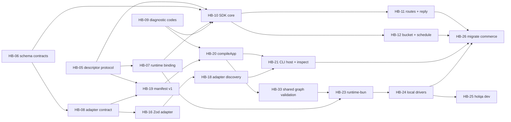

# Requirements backlog after M0

> **Status:** Planned. Every item below is unimplemented work. Items are written so that each can be filed as one GitHub issue; none have been filed yet.

Identifiers are stable for cross-referencing (`HB-NN`). "Depends on" lists items that must be done first. Every item's definition of done also includes the repository's standing rules: tests under `tests/`, documentation and status labels updated, `pnpm check` passing, and a changeset for user-visible package changes.

## Dependency overview

## Tooling and repository

| ID | Item | Depends on | Acceptance criteria |
| --- | --- | --- | --- |
| HB-01 | Validate package exports in `pnpm check` and CI. | none | publint and Are the Types Wrong run for every non-example package with a `dist/`. A broken `exports` map fails the gate. The tools are pinned dev dependencies, not `npx` downloads. |
| HB-02 | Resolve the `dot-notation` / `noPropertyAccessFromIndexSignature` conflict. | none | `pnpm lint:fix` never rewrites code into a type error. A regression fixture shows that `record["key"]` on an index signature is accepted by both tools. The change is documented in `docs/contributing/code-style.md`. |
| HB-03 | Document baseline-validation pitfalls. | none | `docs/contributing/development.md` and the testing skill explain `--force` with the shared worktree cache, TypeScript 6's TS5112 for file arguments, and Bun's missing `expectTypeOf().parameter()`. |
| HB-30 | Align `@types/bun` with the pinned runtime. | none | `@types/bun` resolves to the same minor version as `.bun-version` (today it is 1.4.3 against Bun 1.3.13), or the mismatch is pinned and documented, so the types do not advertise APIs such as `Bun.ModuleGraph` that the runtime lacks. |
| HB-31 | Document tsdown output extensions for `platform: "node"`. | none | The package template and the typescript-library skill say that `platform: "node"` emits `.mjs` unless `fixedExtension: false` is set, so the output matches `./dist/index.js` exports. |
| HB-04 | Enforce the new layer rows in `check-boundaries.ts`. | none | Schema-adapter packages may depend on `@holqa/core` only. Future `packages/providers/*` may depend on `@holqa/core` only. Type-only imports (`import type`, `export type`), which `Bun.Transpiler.scanImports` drops, and relative imports that leave the package are checked too. Each rule has a failing-case test or fixture. |

## Core contracts (`@holqa/core`)

| ID | Item | Depends on | Acceptance criteria |
| --- | --- | --- | --- |
| HB-05 | Descriptor protocol ([ADR 0013](../../architecture/decisions/0013-descriptor-protocol-in-core.md)). | none | `~holqa` descriptors for app, resource, handler and config with `protocol: 1`. Structural readers (`getDescriptor` and friends) reject unknown versions. Tests cover duplicate-package interoperability with a second copy of the module. |
| HB-06 | Standard Schema structural types and `validateInput`. | none | No schema-library dependency. Async validation is always awaited. Issue paths are normalized to JSON-safe data. Negative type tests reject non-schemas. |
| HB-07 | `RuntimeBinding`, `bindApp`, `requireBinding`. | HB-05 | Rebinding is rejected. Unbound use fails with `HOLQA_RUNTIME_NOT_BOUND` and a hint about top-level access. |
| HB-08 | `SchemaAdapter` contract. | HB-06 | `fidelity: "verified" \| "unverified"`, structured `runtimeOnly` entries (`path`, `kind`, `detail`), and an exact `library` version ([ADR 0016](../../architecture/decisions/0016-schema-adapters-and-conversion-fidelity.md)). |
| HB-09 | Register the M0 diagnostic codes. | none | The codes in the [API design](../../reference/api-design.md#diagnostic-codes-proposed-by-m0) are in `diagnosticCodes`, with `HOLQA_SCHEMA_RUNTIME_ONLY` and `HOLQA_HANDLER_FAILED` (handler threw; used for 500 responses and dead-letter reasons without leaking the error) added, and documented in `docs/reference/diagnostic-codes.md`. |

## SDK (`@holqa/sdk`)

| ID | Item | Depends on | Acceptance criteria |
| --- | --- | --- | --- |
| HB-10 | `defineApp`, `defineResources`, `queue`, `secret`, `variable`. | HB-05, HB-06, HB-07, HB-09 | Matches the [API design](../../reference/api-design.md). `send` puts the input form on the wire. A type-level corpus equivalent to `experiments/sdk/tests/app.inference.test.ts` passes, including negative tests. Built declarations are consumed by `package-smoke`. |
| HB-11 | `http.api` routes with `reply`. | HB-10 | Path-parameter inference and exact `params` checks, no body on `GET`/`DELETE`, `reply` status and body checks, and response validation. Readable type errors for mismatched `params`. |
| HB-12 | `bucket` and `schedule`. | HB-10 | Portable object event schema without a schema library. `scheduledTime` is required at invocation. |
| HB-13 | Design RPC procedures. | HB-11 | An ADR covering the procedure shape, query/mutation classification, the output helper (because of literal widening), and client contract types. |
| HB-14 | Design typed middleware. | HB-11 | An ADR and type prototype for context extension at app, API and route level, with an inference scale measurement. |
| HB-15 | Type-checking scale benchmark in CI. | HB-10, HB-11 | A benchmark like `experiments/sdk/bench/type-scale.ts` runs in CI and fails if instantiations per resource grow more than 50% over the recorded baseline. |

## Schema adapters

| ID | Item | Depends on | Acceptance criteria |
| --- | --- | --- | --- |
| HB-16 | Zod adapter package. | HB-08 | Detects refinements, `trim`, case transforms, transforms, promises, files, dates and bigints as in the M0 corpus. Runs the corpus against every supported Zod minor version. One package per library (or per-library subpath exports), so a Zod-only application never resolves Valibot. |
| HB-17 | Valibot adapter package. | HB-08 | The same corpus. Documents Valibot's `isoDateTime` and output-default discrepancies. |
| HB-18 | Decide how hosts obtain adapters. | HB-16 | An ADR choosing between declaring adapters in `defineApp`, a tool configuration file, or vendor-name resolution. The CLI and compiler gain no build-time dependency on integrations. |

## Compiler

| ID | Item | Depends on | Acceptance criteria |
| --- | --- | --- | --- |
| HB-19 | Manifest schema v1 and normalization specification. | HB-05, HB-08 | A versioned, documented schema for the manifest. Normalization rules (removed keywords, set-like arrays) are versioned with it. Fixtures pin canonical bytes. |
| HB-20 | `compileApp` graph validation. | HB-19, HB-09 | Every diagnostic from the [compilation experiment](../../../experiments/compiler/README.md#diagnostics-all-collected-never-first-error-only-deterministically-sorted) is reported, with all problems collected and deterministically sorted. The compiler stays runtime-neutral. |
| HB-21 | CLI host and `holqa inspect --json`. | HB-20, HB-18 | The CLI evaluates modules in a child process with secrets stripped from its environment, and reports evaluation failures as `HOLQA_MODULE_EVALUATION_FAILED`. Byte-identical output across runs and paths is tested. |
| HB-33 | One graph-validation function in the contract layer. | HB-20 | The compiler and the runtime's development loader call the same validation (identifiers, references, consumers, routes, trigger kinds, unknown protocol versions as errors). The M0 prototypes diverged here. |
| HB-22 | Document the build-time trust model. | HB-21 | `docs/concepts/security.md` and the CLI help state that compiling runs application code ([ADR 0014](../../architecture/decisions/0014-evaluation-based-manifest-extraction.md)). |

## Runtime and local development

| ID | Item | Depends on | Acceptance criteria |
| --- | --- | --- | --- |
| HB-23 | `@holqa/runtime-bun` generations, invocation, cancellation and disposal. | HB-07 | Implements [ADR 0015](../../architecture/decisions/0015-runtime-generations-and-reload.md): atomic generation swap, in-flight work pinned to its generation after slot acquisition, a failed reload keeps the old generation, per-handler concurrency limits shared across generations, settlement exactly once, orphans keep their slots, runtime-owned queues and buckets, and a parse pre-check plus import timeouts. A stress test equivalent to the M0 experiment passes for each strategy. |
| HB-24 | `@holqa/local` drivers: queue, bucket, scheduler. | HB-23 | At-least-once delivery with attempts, dead-lettering and duplicate simulation, and no stronger guarantees than production drivers. Semantics are documented per driver. |
| HB-25 | `holqa dev` with reload. | HB-24, HB-21 | One Worker per generation. File changes trigger a new generation; a failed reload (including a syntax error) reports diagnostics and keeps serving. The worker process is restarted after a bounded number of reloads to cap RSS, and `orphaned` handlers are shown. |
| HB-32 | Per-invocation context for ambient handles. | HB-23 | Decide whether `send` and other handle calls inside a handler inherit the invocation's signal and trace context (for example through `AsyncLocalStorage` in the runtime), and prototype the chosen approach. |

## Examples, bindings and policy

| ID | Item | Depends on | Acceptance criteria |
| --- | --- | --- | --- |
| HB-26 | Migrate `examples/commerce` to the real packages and delete `experiments/`. | HB-11, HB-12, HB-21, HB-24 | The example imports `@holqa/sdk`. Its tests compile and run it with the real compiler and runtime. `experiments/` and its boundary table are removed. |
| HB-27 | Infrastructure binding format and capability vocabulary. | HB-07 | Validates or revises [ADR 0005](../../architecture/decisions/0005-infrastructure-independent-resource-contracts.md) with the local provider and at least one external driver design. An unsatisfied requirement fails with `HOLQA_BINDING_CAPABILITY_UNSUPPORTED`. |
| HB-28 | Decide validation-on-send policy. | HB-10 | An ADR or documented decision, with benchmark numbers for validation cost (M0 measured about 2 µs per Zod object). |
| HB-29 | Static route precedence. | HB-20, HB-23 | The compiler's ambiguity rule and the router's precedence (static before parameter segments) are specified once and tested in both. |

## Related

- [M0 summary](index.md)
- [Roadmap](../../roadmap.md)
