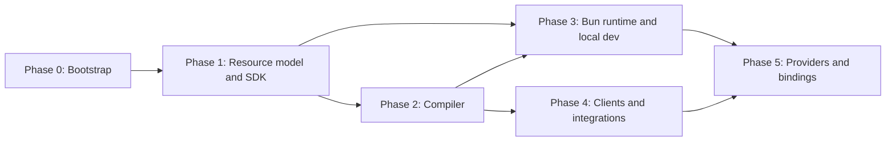

# Roadmap

> **Status:** Phase 0 to phase 3, the event safety milestone (M8), the observability milestone (M9) and the advanced local development milestone (M10) are in progress. Later phases are **Planned**. This roadmap has no dates; phases are ordered by dependency, not by calendar.

This roadmap distinguishes the current bootstrap state from future implementation work. Status terms follow the [status model](architecture/status-model.md). Each phase lists its goals and the exit criteria that must hold before the phase is considered complete. Later phases may start before earlier ones finish when the dependency allows it.

## Overview

| Phase | Name | Status |
| --- | --- | --- |
| 0 | Bootstrap | In progress |
| M0 | Foundation and architecture validation | Complete (see [M0](milestones/m0/index.md)) |
| 1 | Core resource model and SDK | In progress |
| 2 | Compiler | In progress (manifest, discovery, validation, `inspect` and `build --manifest` **Implemented**) |
| 3 | Bun runtime and local development | In progress (runtime, `@holqa/local` drivers, `holqa dev`, the operation commands and `createTestApp` **Implemented**; worker isolation Planned) |
| M8 | Event safety, reliability and execution safeguards | In progress (cycle analysis, event lineage, runtime limits, idempotency, controlled redrive and test utilities **Implemented**; backlog thresholds and budgets on other bindings Planned) |
| M9 | Observability, structured logging and telemetry | In progress (structured logging with redaction, tracing, framework metrics, OTLP/HTTP export, the local telemetry store, the telemetry commands and test helpers **Implemented**; trace timeline view and OpenTelemetry API bridge Planned) |
| M10 | Advanced local development, backend HMR and debugging | In progress (versioned handler registry, hot handler replacement in `holqa dev`, the local development dashboard, recording, replay and causal chains in `@holqa/testing` **Implemented**; module unloading, worker isolation and type checking during reload Planned) |
| 4 | Clients and integrations | Planned |
| 5 | Providers and bindings | Planned |
| Future | Extended triggers and tooling | Planned |

## Phase 0: Bootstrap

**Goal:** A trustworthy, well-documented, agent-ready repository foundation. No framework functionality.

### Done

| Item | Status |
| --- | --- |
| pnpm 12 workspace with catalogs and a committed `pnpm-lock.yaml` | **Implemented** |
| Turborepo task graph (`build`, `typecheck`, `lint`, `test`, `dev`, `clean`, and root gates), with `pnpm check` as the single quality gate | **Implemented** |
| Strict shared TypeScript configuration (TypeScript 6, see [ADR 0010](architecture/decisions/0010-typescript-6-until-tooling-supports-7.md)) | **Implemented** |
| Shared ESLint flat config based on `@antfu/eslint-config`, including JSDoc summary enforcement and architectural import restrictions | **Implemented** |
| tsdown builds producing ESM `.js` and bundled `.d.ts`, with `@/` aliases resolved ([ADR 0011](architecture/decisions/0011-path-aliases-in-library-packages.md)) | **Implemented** |
| Bun test runner with tests under `tests/` mirroring `src/` ([ADR 0009](architecture/decisions/0009-test-placement-and-typescript-standards.md)) | **Implemented** |
| Package boundary checks (`scripts/check-boundaries.ts`) | **Implemented** |
| Agent instructions, rules, and skills with sync and drift check (`pnpm agents:sync`, `pnpm agents:check`) | **Implemented** |
| `@holqa/core` primitives: `Result`, `Diagnostic`, diagnostic code registry, `ResourceId` | **Implemented** |
| `@holqa/compiler` canonical JSON serialization | **Implemented** |
| `@holqa/cli` help, version, `--json`, and structured "not implemented" diagnostics | **Implemented** |
| `examples/package-smoke` verifying built package outputs | **Implemented** |
| Architecture documentation and ADRs 0001–0011 | **Implemented** (as documents) |
| GitHub Actions CI workflow (`.github/workflows/ci.yml`) and Changesets configuration (publishing disabled) | **Implemented** (configured) |

### Remaining exit criteria

- CI is confirmed passing on pull requests in the hosted repository.
- Automated publishing stays disabled until release ownership and credentials are configured.
- Repository owner confirms the license (Apache-2.0) before any public release.
- Documentation has no broken relative links.

## M0: Foundation and architecture validation

**Goal:** Confirm that the scaffold's checks, package boundaries, toolchain and proposed APIs work together, and find fundamental limitations of the programming model before the SDK accumulates code.

Outcome: the baseline passes, the package layers are confirmed and extended ([ADR 0017](architecture/decisions/0017-package-layers-after-m0.md)), and four disposable experiments under [`experiments/`](../experiments/README.md) recorded their results. ADRs 0012–0017 record the decisions, and the [backlog](milestones/m0/backlog.md) lists the follow-up work with dependencies and acceptance criteria. Nothing from M0 is a framework capability: the experiments are **not** Implemented framework features.

## Phase 1: Core resource model and SDK

**Goal:** Developers can declare an application's resources in `infra.ts` with full type inference, even though nothing executes yet.

### Done

| Item | Status |
| --- | --- |
| Logical resource model in `@holqa/core`: descriptor protocol, typed resource and trigger kind registries, capability requirements, handler metadata separated from `invoke`, runtime binding contract ([resource model](architecture/resource-model.md), ADRs 0018 to 0020) | **Implemented** |
| `defineApp`, `defineResources`, `composeResources`, `queue`, `bucket`, `schedule`, `http.api`, `secret`, `variable` as pure declarations with declaration-time validation | **Implemented** |
| Typed handles inferred from declarations, across modules, with no generated code | **Implemented** |
| Handler registration for queues, buckets and schedules | **Implemented** |
| HTTP routes with `reply`, RPC procedures, typed middleware and `scoped` values ([runtime reference](reference/runtime.md)) | **Implemented** |
| Composition of resource registries from multiple files ([composing applications](concepts/composing-applications.md)) | **Implemented** |
| Type-level tests, including negative tests, for every implemented resource kind; `@holqa/testing` type assertions | **Implemented** |
| Schema system: structured validation errors, JSON wire payloads validated after encoding, versioned message envelopes, the `SchemaAdapter` contract, normalization into canonical contracts, fingerprints and a compatibility checker ([schema contracts](reference/schema-contracts.md), [ADR 0021](architecture/decisions/0021-schema-contracts-wire-payloads-and-compatibility.md)) | **Implemented** |
| The first schema adapter: `@holqa/zod` for Zod 4 | **Implemented** |

### Remaining goals

- Extend the `ResourceId` grammar decision ([ADR 0004](architecture/decisions/0004-stable-logical-resource-identities.md)) and finalize it before 1.0.

### Exit criteria

- Type-level tests (including negative tests with `@ts-expect-error`) prove inference for every resource kind.
- Declarations are plain data plus schemas; constructing them has no side effects.
- Unsupported schemas produce an explicit diagnostic such as `HOLQA_SCHEMA_UNSUPPORTED`.
- `@holqa/sdk` obeys its boundaries: no imports of compiler, runtime, Bun, or Node modules.

## Phase 2: Compiler

**Goal:** Turn an application's declarations and handlers into a deterministic, versioned, infrastructure-neutral manifest with structured diagnostics. See [compiler architecture](architecture/compiler.md).

### Done

| Item | Status |
| --- | --- |
| Versioned manifest (version 1) and entry point map with published JSON Schemas, TypeScript types and validating readers ([compiler specification](reference/compiler-specification.md), [ADR 0022](architecture/decisions/0022-manifest-v1-and-entry-point-map.md)) | **Implemented** |
| Application loading (`infra.ts`) and handler discovery with the glob patterns declared in `defineApp`, evaluated in a separate process with an allowlisted environment | **Implemented** |
| Static validation: duplicate resource and handler identifiers, references to undeclared resources, trigger kind mismatches, one consumer per queue, conflicting routes, unknown settings, invalid schemas | **Implemented** |
| Schema contracts (fingerprint, source, `schemaVersion`) recorded in the manifest's schema table | **Implemented** |
| Resource graph builder (`buildResourceGraph`) and required capabilities | **Implemented** |
| `holqa inspect` (text and `--json`) and `holqa build --manifest` | **Implemented** |
| Byte-identical manifests across processes, working directories and application locations, verified by [`examples/manifest`](../examples/manifest/README.md) | **Implemented** |

### Remaining goals

- Compare the manifest with a previously deployed manifest using the **Implemented** compatibility checker.
- Bundle executable artifacts from the entry point map (`holqa build` without `--manifest`).
- Check required capabilities against a selected binding at build time.
- Harden analysis with a real sandbox (restricted file system and network) when one is practical on Bun.

### Exit criteria

- The same inputs produce byte-identical manifests across runs and machines. **Met** for runs, working directories and application locations on one machine; cross-machine runs are covered by the same guarantees but not yet by CI on several platforms.
- Every compiler failure is a `Diagnostic` with a registered `HOLQA_*` code and, where possible, a source location. **Met.**
- `holqa inspect --json` returns the resource graph as stable JSON. **Met.**
- Compilation and bundling are separate steps with separate outputs ([ADR 0007](architecture/decisions/0007-separate-compiler-and-runtime.md)). **Met** for the manifest; bundling is not implemented.

## Phase 3: Bun runtime and local development

**Goal:** Run a Holqa application locally on Bun without cloud credentials. See [local development](concepts/local-development.md) and [triggers and execution](concepts/triggers-and-execution.md).

### Done

| Item | Status |
| --- | --- |
| `@holqa/runtime-bun`: one invocation dispatcher (identifiers, time limits, cancellation, bounded concurrency, error normalization, structured logs) and the application lifecycle (start, graceful stop, application-scoped values) ([runtime reference](reference/runtime.md), [ADR 0023](architecture/decisions/0023-common-invocation-engine-and-http-rpc-execution.md)) | **Implemented** |
| HTTP routing on the Fetch API, request validation, typed responses, CORS and streaming; RPC procedures (`holqa.rpc/1`) on the same HTTP runtime | **Implemented** |
| Typed middleware at application, API and route scope | **Implemented** |
| Loading `holqa build --manifest` output and serving it with `Bun.serve`, verified by [`examples/http-api`](../examples/http-api/README.md) | **Implemented** |
| Queue, object event and schedule transports on the dispatcher: leased at-least-once delivery, retries with declared backoff, dead-lettering, bounded consumer concurrency, overlap policies, graceful shutdown ([runtime reference](reference/runtime.md), [ADR 0024](architecture/decisions/0024-event-delivery-sources-and-local-drivers.md)) | **Implemented** |
| `@holqa/local`: SQLite-backed queues and event state, filesystem object storage with events and development signed URLs, a scheduler driven by an injectable clock, inspection and failure simulation ([local environment](reference/local.md)) | **Implemented** |
| An event-driven application running end to end locally (HTTP upload, object event, queue consumer with retries and dead-lettering, scheduled cleanup), verified by [`examples/document-processing`](../examples/document-processing/README.md) | **Implemented** |
| `holqa dev`: a development supervisor with a stable address, a generation process per reload started in two phases, change classification (`implementation`, `environment`, `handlers`, `resources`), contract diagnostics on schema changes, and a session lock ([ADR 0025](architecture/decisions/0025-dev-supervisor-and-process-generations.md), [local development guide](guides/local-development.md)) | **Implemented** |
| `holqa invoke`, `holqa queue send`, `holqa storage put`, `holqa cron run`, `holqa state` and `holqa doctor`, with `--json` output and stable exit codes, running in the dev session when there is one ([CLI reference](reference/cli.md)) | **Implemented** |
| Trace correlation: `correlationId` and `causationId` carried through queue messages and object events, emitted messages and objects in outcomes and logs, handler source locations in failure logs ([runtime reference](reference/runtime.md)) | **Implemented** |
| `@holqa/testing`: `createTestApp` with isolated local state, a virtual clock, event flushing, failure injection, duplicate delivery and disposal | **Implemented** |
| A local event-processing application run with `holqa dev` and tested end to end with controlled failures, verified by [`examples/order-pipeline`](../examples/order-pipeline/README.md) | **Implemented** |

### Goals

- `@holqa/runtime-bun`: worker isolation for production runtimes.
- Hot handler replacement and the local development dashboard moved to [M10](#m10-advanced-local-development-backend-hmr-and-debugging), where they are **Implemented**; module unloading and a Vite module runner integration remain **Planned** there.

### Exit criteria

- An example application runs end to end locally with HTTP, a queue consumer, and a schedule. **Met** by `examples/document-processing`.
- Local emulators document their delivery and concurrency semantics and do not promise stronger guarantees than production drivers are expected to offer. **Met** for `@holqa/local` ([local environment](reference/local.md)).
- Runtime validation runs at every trust boundary (incoming HTTP, queue messages, storage events). **Met**.
- A developer can clone an example, install dependencies, run `holqa dev` and exercise the application without infrastructure credentials; a changed handler serves the next execution, a schema change reports contract diagnostics, and repeated restarts leave one generation process and one consumer per queue. **Met** by `examples/order-pipeline` and the CLI's dev session tests.

## M8: Event safety, reliability and execution safeguards

**Goal:** Applications cannot accidentally cause unbounded work, overwhelm their resources, or silently corrupt asynchronous processing through incorrect event-handling logic. See [event safety](concepts/event-safety.md) and [ADR 0026](architecture/decisions/0026-event-safety-analysis-lineage-and-execution-guards.md).

### Done

| Item | Status |
| --- | --- |
| Event dependency graph: resource and handler nodes, consumption and publication edges with `known`, `potential` and `unknown` certainty, from static analysis of handler code and declared `events.publishes` | **Implemented** |
| Cycle analyzer: direct and indirect cycles as strongly connected components, `HOLQA_EVENT_CYCLE` warnings (known) and information (potential) with paths and locations; justified cycles (`events.cycle`) reported as allowed | **Implemented** |
| `holqa inspect --cycles`, text and `--json` | **Implemented** |
| Event lineage: `rootId`, `causationId`, `correlationId` and `depth` in every trace, with propagation rules; `context.lineage` in handlers | **Implemented** |
| Runtime execution guards: depth and publication limits in every runtime, event age where the binding reports send times, per-operation budgets where the binding provides atomic accounting; terminal outcomes instead of retries | **Implemented** |
| Idempotency: the `IdempotencyStore` contract, key conventions, an in-memory store, the local SQLite store, and handler-level `idempotency` | **Implemented** |
| Controlled replay: `holqa queue redrive` with `--message`, `--limit`, `--dry-run` and `--new-operation` | **Implemented** |
| Test utilities: `maxInvocations` simulation budget, `lineage` and `operation` inspection, event limits in `createTestApp`, cycle fixtures | **Implemented** |
| Reliability documentation: limits, guarantees, intentional cycles and unsupported cases | **Implemented** (as documents) |

### Remaining goals

- Queue backlog thresholds and backpressure on producers.
- Per-operation budgets for bindings to external services, with atomic accounting in the service.
- Declared event policies in a future manifest version, so tools can read them without loading code.
- An HTTP `Idempotency-Key` convention for routes and procedures.

### Exit criteria

- A direct self-publishing queue handler produces a clear compiler diagnostic. **Met** (`HOLQA_EVENT_CYCLE`, compiler tests and `examples/event-safety`).
- An indirect queue A → B → A cycle is detected when its edges are statically known. **Met.**
- A legitimate terminating cycle can be permitted without disabling all safety features. **Met** (`events.cycle`: other cycles are still reported, runtime limits still apply).
- A runaway chain is stopped by an enforceable runtime policy and produces a terminal diagnostic. **Met** (`HOLQA_EVENT_DEPTH_EXCEEDED`, `HOLQA_EXECUTION_BUDGET_EXCEEDED`; dead-lettered without retries).
- Duplicate delivery and retry tests demonstrate the documented idempotency guarantees and limitations. **Met** (`@holqa/testing` and `examples/event-safety`).
- Independent invocations do not accidentally share lineage or execution-budget state. **Met** (roots are runtime-assigned; requests sharing a caller's correlation identifier get separate budgets).

## M9: Observability, structured logging and telemetry

**Goal:** Observe executions across HTTP, RPC, queues, storage events and scheduled tasks in one way, without requiring a specific monitoring provider. See [observability](concepts/observability.md) and [ADR 0027](architecture/decisions/0027-observability-telemetry-and-local-inspection.md).

### Done

| Item | Status |
| --- | --- |
| Observability core in `@holqa/core`: W3C trace context, the telemetry data model and `TelemetryExporter`, the framework metric registry, redaction | **Implemented** |
| Structured logger: `log.debug/info/warn/error` with application, handler, invocation, correlation, lineage and trace identifiers; level filtering; configurable sinks; redaction of sensitive field names and declared secret values | **Implemented** |
| Execution instrumentation: spans for HTTP routes, RPC procedures, queue and object event processing, scheduled runs, direct invocations, queue sends and storage operations; propagation across HTTP (`traceparent`) and messages and object events (`DeliveryTrace.traceparent`), parent and link relationships following OpenTelemetry's messaging conventions | **Implemented** |
| Framework metrics with closed attribute lists and a series limit: invocations, durations, failures, active invocations, queue backlog, processing durations, retries, dead letters, blocked events, HTTP durations, reload failures, dropped telemetry | **Implemented** |
| Bounded export pipeline: buffers, batches, time limits, isolated exporter failures, rate-limited `HOLQA_TELEMETRY_EXPORT_FAILED` reports, flush on stop | **Implemented** |
| OpenTelemetry adapter `@holqa/opentelemetry`: OTLP/HTTP JSON exporter for traces, metrics and logs, standard `OTEL_*` variables | **Implemented** |
| Local telemetry store (`telemetry.sqlite`) with bounded retention, and the CLI: `holqa logs [--follow]`, `holqa traces list`, `holqa traces inspect`, `holqa events inspect`, `holqa metrics` | **Implemented** |
| Test helpers: in-memory telemetry in `createTestApp`, `createMemoryTelemetry`, `spanTree` | **Implemented** |
| Privacy and performance policies: sampling, retention, redaction, cardinality and overhead, documented in [observability](concepts/observability.md) | **Implemented** (as documents and enforced limits) |

### Remaining goals

- A graphical trace and event timeline view. The read-only local development dashboard of `holqa dev` lists traces from the local telemetry store ([M10](#m10-advanced-local-development-backend-hmr-and-debugging)); a timeline or flame view is not implemented.
- A bridge to `@opentelemetry/api`, so spans created by application code and instrumented libraries join Holqa's traces.
- OTLP over protobuf or gRPC, and exporter retries with backoff.
- Telemetry for bindings to external services, validated against their own propagation formats.

### Exit criteria

- A test application can receive an HTTP request, publish a queue message, process it, write an object, and produce correlated diagnostic data. **Met** (`examples/observability`, `@holqa/testing`).
- Logs identify the relevant execution without leaking declared secret values. **Met** (redaction tests in `@holqa/core`, `@holqa/runtime-bun` and `examples/observability`).
- A standard OTLP-compatible setup receives usable traces and metrics, validated against the supported Bun versions. **Met** against a stand-in OTLP/HTTP receiver in `examples/observability` on Bun 1.3.13; validation against an OpenTelemetry Collector process in CI is not automated yet.
- The framework remains operational when telemetry collection is disabled or an exporter is unavailable, with bounded buffering and defined failure policies. **Met** (runtime and example tests with failing and unreachable exporters).

## M10: Advanced local development, backend HMR and debugging

**Goal:** Change backend code without losing the running local session, see the state of the development session in one place, and reproduce and step through event chains in tests. See [local development](concepts/local-development.md), the [local development guide](guides/local-development.md) and [ADR 0028](architecture/decisions/0028-hot-handler-replacement.md).

### Done

| Item | Status |
| --- | --- |
| Versioned handler registry in `@holqa/runtime-bun`: `Runtime.replaceHandlers` installs new implementations as one registry version; invocations are pinned to the implementation current when they get their concurrency slot; replaced versions retire when their last invocation finishes, with a per-version application scope whose signal aborts at retirement; `handlerVersions()`, `stats().versions`, `handlerVersion` in invocation logs; definition changes rejected with `HOLQA_HANDLER_REPLACEMENT_INVALID` | **Implemented** |
| Hot handler replacement in `holqa dev`: changes that leave the manifest and entry point map unchanged and only touch handler modules (or modules only they import) are rebundled, evaluated with side-effect detection and swapped in the running generation process; everything else falls back to a process restart that keeps local state; `--no-hot` | **Implemented** |
| Stale state: a broken change keeps the last working code serving and the session reports it as stale; `handlers.swapped`, `handlers.swap-failed` and `handlers.swap-refused` events and a `reload` field on `build` in the dev JSON output | **Implemented** |
| Queue safety during replacement: consumers are never re-registered; messages already waiting are checked against a changed queue contract and reported as `HOLQA_QUEUED_MESSAGE_INCOMPATIBLE` warnings | **Implemented** |
| Read-only local development dashboard at `/_holqa/dashboard` on loopback addresses (handlers with versions, resources, queue backlog and dead letters, schedules, reload history and stale state, build diagnostics, recent logs and invocations, traces); never shows message payloads; `--no-dashboard` | **Implemented** |
| `@holqa/testing`: `TestApp.recording()` (sanitized `holqa.recording/1`), `TestApp.replay` through the virtual clock, `TestApp.chain` for stepping through a causal chain | **Implemented** |

### Remaining goals

- Module unloading: old module copies stay in memory until the process restarts.
- Worker isolation for handler execution.
- Type checking during reload (`holqa dev` does not run `tsc`).
- A Vite module runner integration.
- Client regeneration on contract changes, once [clients](#phase-4-clients-and-integrations) exist.
- Feature-flag overrides in the dashboard, and an interactive debugger with breakpoint stepping.

### Exit criteria

- A changed handler serves the next invocation without restarting the generation process, while in-flight invocations finish on the old implementation. **Met** (runtime and CLI dev session tests).
- Changes that cannot be applied safely fall back to a process restart that keeps local state. **Met** (reload plan and dev session tests).
- A broken change does not take down the running application and is reported as stale. **Met** (dev session tests).
- Hot replacement never registers a second consumer for a queue. **Met** (dev session tests).
- A recorded event chain can be replayed deterministically in a test. **Met** (`@holqa/testing` tests).

## Phase 4: Clients and integrations

**Goal:** Holqa composes with the TypeScript ecosystem instead of replacing it. See [integrations](integrations/index.md).

### Goals

- `@holqa/client`: framework-independent, browser-safe generated client runtime over the Fetch API.
- OpenAPI generation for HTTP APIs (`holqa openapi generate`).
- TanStack Query integration: typed query and mutation options and query keys.
- oRPC and Hono interoperability.
- Vite integration for single-origin development and static builds.
- Valibot and Effect Schema adapters; Effect handler adapter.

### Exit criteria

- Generated clients contain no handler code, internal functions, credentials, or secrets, verified by tests.
- Each integration lives in its own package under `packages/integrations/` and depends only on `@holqa/core`, `@holqa/sdk`, or `@holqa/client`.
- Final npm names for integration packages are decided.

## Phase 5: Providers and bindings

**Goal:** Bind the infrastructure-neutral manifest to real infrastructure. See [infrastructure providers](concepts/infrastructure-providers.md).

### Done

| Item | Status |
| --- | --- |
| Versioned binding contracts, the provider protocol (`BindingProvider`, roles, validation), classified binding failures, lifecycle and health types, per-resource capability checks ([ADR 0029](architecture/decisions/0029-binding-provider-protocol-and-versioned-contracts.md), [binding contracts](reference/bindings.md)) | **Implemented** |
| Binding configurations: `defineBindings`, deterministic resolution (resource, kind, default), independent service selection, composition into one runtime binding whose lifecycle the runtime drives ([ADR 0030](architecture/decisions/0030-binding-composition-and-resolution.md)) | **Implemented** |
| Capability negotiation: the required-capability vocabulary on both sides, native and emulated support, quantitative limits (delays, message size, signed URL expiry, execution limits), topology checks, and `holqa bindings inspect`, `holqa bindings validate` and `holqa inspect --capabilities`, all without connecting to infrastructure | **Implemented** |
| The local binding as providers (`local.platform`, per-kind providers, `sqlite` and `memory` persistence) on the same engine as `createLocalEnvironment`, and the reusable provider conformance suite (`@holqa/conformance`) | **Implemented** |
| Static frontend hosting: the `static.site` resource kind and contract, `staticSite`, runtime serving after routes, local hosting with SPA fallback ([ADR 0031](architecture/decisions/0031-static-sites-as-a-resource-kind.md)) | **Implemented** |
| The local development workflow through the binding layer (`holqa dev` composes the local platform or a `--bindings` configuration; binding changes restart the generation), in-memory test state and provider fault injection (`withFaults`) | **Implemented** |
| Typed, versioned provider extensions: definitions, required and optional declarations, selection in binding configurations, start-time checks, credential isolation, and the reference `holqa.app-cache` extension ([ADR 0032](architecture/decisions/0032-typed-versioned-provider-extensions.md)) | **Implemented** |
| A RabbitMQ queue provider (`@holqa/rabbitmq`), passing the queue conformance suite against an in-memory broker and RabbitMQ 4 in CI | **Implemented** |

### Goals

- Define the provisioning provider contract. The runtime driver and delivery source contracts exist in `@holqa/core` (**Implemented**, implemented locally by `@holqa/local`); drivers for external services are Planned.
- One or two initial runtime drivers (for example an S3-compatible storage driver and a self-hostable queue) chosen to validate the abstraction, not to favor a vendor.
- A first provisioning provider that produces a reviewable plan and never deletes physical infrastructure implicitly.
- Extend `holqa doctor` (**Implemented** for the local binding) to validate bindings for external services.

### Exit criteria

- A binding that cannot satisfy a declared requirement fails with a diagnostic; nothing is silently downgraded.
- Runtime drivers operate with least-privilege credentials that do not include provisioning permissions.
- Destructive infrastructure changes require explicit confirmation.

## Future

These capabilities have extension points in the design but no committed phase. All are **Planned**.

| Capability | Notes |
| --- | --- |
| Event topics and fan-out | Independent subscriptions; distinct from single-consumer queues. |
| WebSocket handlers | Built on the HTTP execution model. |
| Durable workflows | Requires durable state and replay semantics. |
| Reactive queries | Requires underlying change-tracking infrastructure; no promise of automatic database reactivity. |
| Database change events | Depends on provider capabilities. |
| External event integrations | Third-party event sources. |
| OpenTelemetry API bridge | Spans created with `@opentelemetry/api` join Holqa's traces. OTLP export of traces and metrics is **Implemented** ([M9](#m9-observability-structured-logging-and-telemetry)). |
| TanStack Start integration | Full-stack hosting integration. |
| Local MCP server | Exposes the resource graph, diagnostics, and local invocations to agents. See [agent-native development](concepts/agent-native-development.md). |
| Schema migration engine | Upgrades data written under an older `schemaVersion`. The compatibility checker and the version metadata it needs are **Implemented**. |
