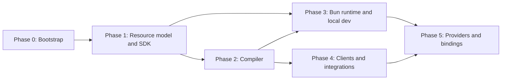

# Roadmap

> **Status:** Phase 0 is in progress. All later phases are **Planned**. This roadmap has no dates; phases are ordered by dependency, not by calendar.

This roadmap distinguishes the current bootstrap state from future implementation work. Status terms follow the [status model](architecture/status-model.md). Each phase lists its goals and the exit criteria that must hold before the phase is considered complete. Later phases may start before earlier ones finish when the dependency allows it.

## Overview

| Phase | Name | Status |
| --- | --- | --- |
| 0 | Bootstrap | In progress |
| M0 | Foundation and architecture validation | Complete (see [M0](milestones/m0/index.md)) |
| 1 | Core resource model and SDK | Planned |
| 2 | Compiler | Planned |
| 3 | Bun runtime and local development | Planned |
| 4 | Clients and integrations | Planned |
| 5 | Providers and bindings | Planned |
| Future | Extended triggers and tooling | Planned |

## Phase 0: Bootstrap

**Goal:** A trustworthy, well-documented, agent-ready repository foundation. No framework functionality.

### Done

| Item | Status |
| --- | --- |
| pnpm 12 workspace with catalogs and a committed `pnpm-lock.yaml` | **Implemented** |
| Turborepo task graph (`build`, `typecheck`, `lint`, `test`, `dev`, `clean`, and root gates), with `pnpm check` as the single quality gate | **Implemented** |
| Strict shared TypeScript configuration (TypeScript 6, see [ADR 0010](architecture/decisions/0010-typescript-6-until-tooling-supports-7.md)) | **Implemented** |
| Shared ESLint flat config based on `@antfu/eslint-config`, including JSDoc summary enforcement and architectural import restrictions | **Implemented** |
| tsdown builds producing ESM `.js` and bundled `.d.ts`, with `@/` aliases resolved ([ADR 0011](architecture/decisions/0011-path-aliases-in-library-packages.md)) | **Implemented** |
| Bun test runner with tests under `tests/` mirroring `src/` ([ADR 0009](architecture/decisions/0009-test-placement-and-typescript-standards.md)) | **Implemented** |
| Package boundary checks (`scripts/check-boundaries.ts`) | **Implemented** |
| Agent instructions, rules, and skills with sync and drift check (`pnpm agents:sync`, `pnpm agents:check`) | **Implemented** |
| `@holqa/core` primitives: `Result`, `Diagnostic`, diagnostic code registry, `ResourceId` | **Implemented** |
| `@holqa/compiler` canonical JSON serialization | **Implemented** |
| `@holqa/cli` help, version, `--json`, and structured "not implemented" diagnostics | **Implemented** |
| `examples/package-smoke` verifying built package outputs | **Implemented** |
| Architecture documentation and ADRs 0001–0011 | **Implemented** (as documents) |
| GitHub Actions CI workflow (`.github/workflows/ci.yml`) and Changesets configuration (publishing disabled) | **Implemented** (configured) |

### Remaining exit criteria

- CI is confirmed passing on pull requests in the hosted repository.
- Automated publishing stays disabled until release ownership and credentials are configured.
- Repository owner confirms the license (Apache-2.0) before any public release.
- Documentation has no broken relative links.

## M0: Foundation and architecture validation

**Goal:** Confirm that the scaffold's checks, package boundaries, toolchain and proposed APIs work together, and find fundamental limitations of the programming model before the SDK accumulates code.

Outcome: the baseline passes, the package layers are confirmed and extended ([ADR 0017](architecture/decisions/0017-package-layers-after-m0.md)), and four disposable experiments under [`experiments/`](../experiments/README.md) recorded their results. ADRs 0012–0017 record the decisions, and the [backlog](milestones/m0/backlog.md) lists the follow-up work with dependencies and acceptance criteria. Nothing from M0 is a framework capability: the experiments are **not** Implemented framework features.

## Phase 1: Core resource model and SDK

**Goal:** Developers can declare an application's resources in `infra.ts` with full type inference, even though nothing executes yet.

### Goals

- Define the logical resource model in `@holqa/core`: resource kinds, contracts, required capabilities, and references between resources ([ADR 0003](architecture/decisions/0003-explicit-resource-declarations.md), [ADR 0005](architecture/decisions/0005-infrastructure-independent-resource-contracts.md)).
- Implement `defineApp` and initial resource factories in `@holqa/sdk` (`http.api`, `queue`, `bucket`, `schedule`, `staticSite`, `secret`, `variable`) as pure, deterministic declarations.
- Implement typed resource handles whose types are inferred from declarations (for example a queue's message type).
- Normalize schemas through the Standard Schema interface and define the internal normalized schema representation ([ADR 0016](architecture/decisions/0016-schema-adapters-and-conversion-fidelity.md)).
- Ship the first schema adapter for Zod.
- Support composing resource registries from multiple files.
- Extend the `ResourceId` grammar decision ([ADR 0004](architecture/decisions/0004-stable-logical-resource-identities.md)) and finalize it before 1.0.

### Exit criteria

- Type-level tests (including negative tests with `@ts-expect-error`) prove inference for every resource kind.
- Declarations are plain data plus schemas; constructing them has no side effects.
- Unsupported schemas produce an explicit diagnostic such as `HOLQA_SCHEMA_UNSUPPORTED`.
- `@holqa/sdk` obeys its boundaries: no imports of compiler, runtime, Bun, or Node modules.

## Phase 2: Compiler

**Goal:** Turn an application's declarations and handlers into a deterministic, versioned, infrastructure-neutral manifest with structured diagnostics. See [compiler architecture](architecture/compiler.md).

### Goals

- Define the versioned manifest schema (the IR), serialized with the existing canonical JSON serializer.
- Configuration discovery (`infra.ts`) and handler discovery (glob patterns declared in `defineApp`).
- Resource graph construction and static validation: duplicate identifiers, invalid references, ambiguous routes, incompatible requirements, invalid schemas.
- Schema fingerprints as a basis for future compatibility checks.
- A documented, honest analysis strategy for user configuration code that does not claim unsandboxed evaluation is secure.
- Expose `holqa build` and `holqa inspect` (currently proposed commands).

### Exit criteria

- The same inputs produce byte-identical manifests across runs and machines.
- Every compiler failure is a `Diagnostic` with a registered `HOLQA_*` code and, where possible, a source location.
- `holqa inspect --json` returns the resource graph as stable JSON.
- Compilation and bundling are separate steps with separate outputs ([ADR 0007](architecture/decisions/0007-separate-compiler-and-runtime.md)).

## Phase 3: Bun runtime and local development

**Goal:** Run a Holqa application locally on Bun without cloud credentials. See [local development](concepts/local-development.md) and [triggers and execution](concepts/triggers-and-execution.md).

### Goals

- `@holqa/runtime-bun`: HTTP routing on the Fetch API, RPC as an HTTP specialization, handler invocation with concurrency limits.
- `@holqa/local`: local queue emulation, filesystem-backed object storage, a local scheduler, event inspection.
- `holqa dev` with fast backend reloads and structured logs.
- `holqa invoke`, `holqa queue send`, `holqa storage put`, `holqa cron run` for manual triggering.
- `@holqa/testing`: deterministic integration testing, including simulated duplicate delivery, retries, and failures.

### Exit criteria

- An example application runs end to end locally with HTTP, a queue consumer, and a schedule.
- Local emulators document their delivery and concurrency semantics and do not promise stronger guarantees than production drivers are expected to offer.
- Runtime validation runs at every trust boundary (incoming HTTP, queue messages, storage events).

## Phase 4: Clients and integrations

**Goal:** Holqa composes with the TypeScript ecosystem instead of replacing it. See [integrations](integrations/index.md).

### Goals

- `@holqa/client`: framework-independent, browser-safe generated client runtime over the Fetch API.
- OpenAPI generation for HTTP APIs (`holqa openapi generate`).
- TanStack Query integration: typed query and mutation options and query keys.
- oRPC and Hono interoperability.
- Vite integration for single-origin development and static builds.
- Valibot and Effect Schema adapters; Effect handler adapter.

### Exit criteria

- Generated clients contain no handler code, internal functions, credentials, or secrets, verified by tests.
- Each integration lives in its own package under `packages/integrations/` and depends only on `@holqa/core`, `@holqa/sdk`, or `@holqa/client`.
- Final npm names for integration packages are decided.

## Phase 5: Providers and bindings

**Goal:** Bind the infrastructure-neutral manifest to real infrastructure. See [infrastructure providers](concepts/infrastructure-providers.md).

### Goals

- Define the runtime driver and provisioning provider contracts.
- Capability negotiation: bindings declare capabilities; the compiler rejects unsupported semantics explicitly.
- Environment-specific bindings.
- One or two initial runtime drivers (for example an S3-compatible storage driver and a self-hostable queue) chosen to validate the abstraction, not to favor a vendor.
- A first provisioning provider that produces a reviewable plan and never deletes physical infrastructure implicitly.
- `holqa doctor` for binding and environment validation.

### Exit criteria

- A binding that cannot satisfy a declared requirement fails with a diagnostic; nothing is silently downgraded.
- Runtime drivers operate with least-privilege credentials that do not include provisioning permissions.
- Destructive infrastructure changes require explicit confirmation.

## Future

These capabilities have extension points in the design but no committed phase. All are **Planned**.

| Capability | Notes |
| --- | --- |
| Event topics and fan-out | Independent subscriptions; distinct from single-consumer queues. |
| WebSocket handlers | Built on the HTTP execution model. |
| Durable workflows | Requires durable state and replay semantics. |
| Reactive queries | Requires underlying change-tracking infrastructure; no promise of automatic database reactivity. |
| Database change events | Depends on provider capabilities. |
| External event integrations | Third-party event sources. |
| OpenTelemetry integration | Traces and metrics for handlers. |
| TanStack Start integration | Full-stack hosting integration. |
| Local MCP server | Exposes the resource graph, diagnostics, and local invocations to agents. See [agent-native development](concepts/agent-native-development.md). |
| Schema compatibility engine | Detects breaking changes against previous deployments. |
