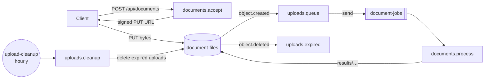

# Document processing example

> **Status:** **Implemented.** Executed by `pnpm test` and `pnpm check` (and therefore CI).

A private workspace package and the reference application for event-driven resources. It is written with
`@holqa/sdk` and Zod, compiled by the **built** `holqa` binary, and runs entirely on this machine with the
`@holqa/local` binding and `@holqa/runtime-bun`. See the [runtime reference](../../docs/reference/runtime.md#queue-delivery)
and the [local environment reference](../../docs/reference/local.md).



| File | What it shows |
| --- | --- |
| [`app/infra.ts`](app/infra.ts) | An `http.api`, a private bucket, a queue with three attempts, exponential backoff and a dead-letter requirement, an hourly schedule with `overlap: "skip"`, and a configuration variable. |
| [`app/src/documents.handler.ts`](app/src/documents.handler.ts) | Validates upload metadata, records the document and returns a signed `PUT` URL; reports a document's status and result. |
| [`app/src/uploads.handler.ts`](app/src/uploads.handler.ts) | `onObjectCreated` turns each upload into a queue job; `onObjectDeleted` records removed uploads. Both tolerate duplicate events. |
| [`app/src/processor.handler.ts`](app/src/processor.handler.ts) | The queue consumer: idempotent by upload `etag`; `#fail-once` fails the first attempt and `#poison` fails every attempt, for the demo. |
| [`app/src/cleanup.handler.ts`](app/src/cleanup.handler.ts) | The schedule handler: pages through `uploads/` and deletes uploads older than `UPLOAD_TTL_HOURS`, measured from the run's scheduled time. |
| [`app/server.ts`](app/server.ts) | Serves the API and the local signed URLs from one `Bun.serve` server, with state in `.holqa/local`. |

| Test ([`tests/document-processing.test.ts`](tests/document-processing.test.ts)) | Asserts |
| --- | --- |
| Upload to result | Over real HTTP: the upload is accepted, stored through its signed URL, reported as a `holqa.object-event/1` event, queued as a versioned job and processed in the background. |
| Validation | Invalid metadata answers `400 HOLQA_INPUT_INVALID` with per-field issues; a wrong content type or an expired URL answers `403 HOLQA_SIGNED_URL_INVALID`. |
| Retry | A failing first attempt is retried after the 2-second backoff and succeeds on attempt 2. |
| Dead letter | A job that fails all three attempts is dead-lettered with its payload, failure code and invocation identifier, which the logs also carry; it can be redriven. |
| Duplicates | A duplicated storage event queues a second job that the processor recognizes and skips. |
| Cleanup | Hourly runs remove the upload once it is older than 24 hours, the deletion event updates the record, results are kept, and a manual run is recorded too. |

Time is controlled with `ManualClock`, so retries, URL expiry and schedules are deterministic.

```bash
pnpm turbo run test --filter=@holqa/example-document-processing
# or run it (after `pnpm build`): builds the manifest, then serves on PORT (default 3000)
pnpm --filter @holqa/example-document-processing start
curl -X POST 127.0.0.1:3000/api/documents -H 'content-type: application/json' -d '{"fileName":"notes.txt","contentType":"text/plain","size":11}'
# PUT the file to the returned upload.url with the returned headers, then:
curl 127.0.0.1:3000/api/documents/<documentId>
```

The application also runs under the development supervisor, which rebuilds and restarts it when a file changes and keeps its local state in `app/.holqa/local` (see the [local development guide](../../docs/guides/local-development.md)):

```bash
cd examples/document-processing
pnpm exec holqa dev --app app/infra.ts
pnpm exec holqa state --app app/infra.ts   # in another terminal
```
