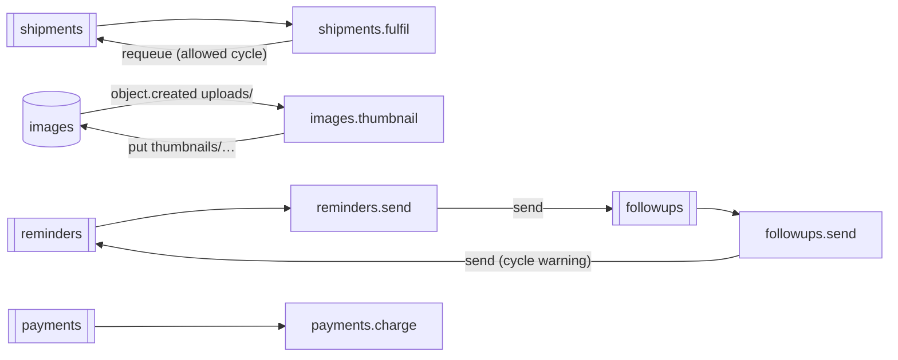

# Event safety example

> **Status:** **Implemented.** Executed by `pnpm test` and `pnpm check` (and therefore CI).

A private workspace package written with `@holqa/sdk` and Zod that shows Holqa's event safety features: static cycle analysis with `holqa inspect --cycles`, runtime depth limits, an intentional cycle declared with a justification, and idempotent processing. The [event safety guide](../../docs/guides/event-safety.md) explains the concepts.



| File | What it shows |
| --- | --- |
| [`app/src/shipments.handler.ts`](app/src/shipments.handler.ts) | A consumer that requeues itself until a terminal condition, with `events.cycle` (justification) and `events.maxDepth`. Reported as an allowed cycle. |
| [`app/src/reminders.handler.ts`](app/src/reminders.handler.ts) | Two consumers that trigger each other without a termination condition: a `HOLQA_EVENT_CYCLE` warning, and stopped at run time by the depth limit. |
| [`app/src/images.handler.ts`](app/src/images.handler.ts) | An object-created handler on `uploads/` that writes under `thumbnails/`; key prefix analysis shows it cannot trigger itself. |
| [`app/src/payments.handler.ts`](app/src/payments.handler.ts) | An idempotent consumer keyed on the payment identifier. |

## Run it

```sh
pnpm --filter @holqa/example-event-safety cycles   # holqa inspect --cycles
pnpm --filter @holqa/example-event-safety test
```

The tests run the built CLI (`tests/cycles.test.ts`) and the application on the local environment with `createTestApp` (`tests/runtime.test.ts`).
