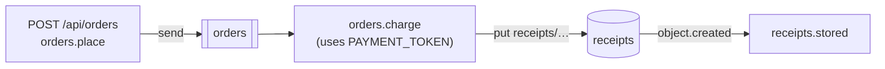

# Observability example

> **Status:** **Implemented.** Executed by `pnpm test` and `pnpm check` (and therefore CI).

A private workspace package written with `@holqa/sdk` and Zod that exercises Holqa's observability end to end. An HTTP
request places an order, a queue consumer charges it with a secret payment token and writes a receipt, and an object
event handler notices the receipt. The [observability guide](../../docs/guides/observability.md) explains the
concepts.



| File | What it shows |
| --- | --- |
| [`app/infra.ts`](app/infra.ts) | The API, the `orders` queue (three attempts, dead-lettering), the `receipts` bucket and the `PAYMENT_TOKEN` secret. |
| [`app/src/orders.handler.ts`](app/src/orders.handler.ts) | The three handlers. The consumer logs the token on purpose, to show that its value and the `authorization` field are redacted. |
| [`tests/telemetry.test.ts`](tests/telemetry.test.ts) | With `createTestApp`: one trace from the HTTP request to the object event handler, log entries that identify every execution, no trace of the secret in logs, spans or exported log records, retries and the dead letter in spans and metrics, and metric attributes without identifiers. |
| [`tests/otlp.test.ts`](tests/otlp.test.ts) | With `createRuntime`, `@holqa/local` and `createOtlpHttpExporter`: a stand-in OTLP/HTTP receiver gets one correlated trace and the framework metrics; with the receiver down, the application keeps working and reports `HOLQA_TELEMETRY_EXPORT_FAILED`. |
| [`tests/cli.test.ts`](tests/cli.test.ts) | The built CLI: `holqa invoke` records telemetry; `holqa traces list`, `traces inspect`, `logs` and `metrics` print it; `OTEL_EXPORTER_OTLP_ENDPOINT` exports the same spans; `events inspect` reports an unknown identifier with `HOLQA_TELEMETRY_NOT_FOUND`. |
| [`tests/support/collector.ts`](tests/support/collector.ts) | A local OTLP/HTTP receiver that accepts JSON on `/v1/traces`, `/v1/metrics` and `/v1/logs` and records what it gets. |

The stand-in receiver checks the OTLP/HTTP JSON requests; the tests do not start an OpenTelemetry Collector process.

## Run it

```sh
pnpm --filter @holqa/example-observability test
```

To run it locally and inspect what it records:

```sh
cd examples/observability
export PAYMENT_TOKEN=pay-tok-7f3a9c
pnpm exec holqa dev --app app/infra.ts
# in another terminal
curl -X POST http://127.0.0.1:3000/api/orders -H 'content-type: application/json' -d '{"orderId":"o-1","amountCents":1250}'
pnpm exec holqa traces list --app app/infra.ts
pnpm exec holqa logs --follow --app app/infra.ts
```

Set `OTEL_EXPORTER_OTLP_ENDPOINT` (for example `http://localhost:4318`) before `holqa dev` to also export to an OTLP
receiver.
