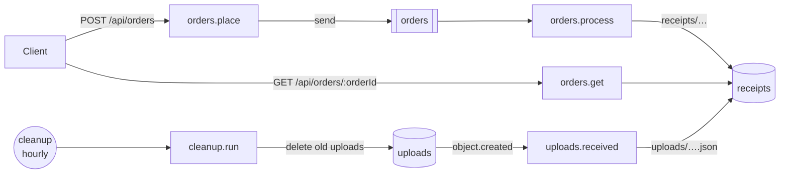

# Order pipeline example

> **Status:** **Implemented.** Executed by `pnpm test` and `pnpm check` (and therefore CI).

The local development example: a private workspace package written with `@holqa/sdk` and Zod that runs with `holqa dev` and is tested with `createTestApp` from `@holqa/testing`. Nothing in it needs infrastructure credentials. The [local development guide](../../docs/guides/local-development.md) walks through it.



| File | What it shows |
| --- | --- |
| [`app/infra.ts`](app/infra.ts) | An `http.api`, a queue with three attempts, exponential backoff and a dead-letter requirement, two private buckets, an hourly schedule and a configuration variable with a default. |
| [`app/src/contracts.ts`](app/src/contracts.ts) | The order message (version 1) and receipt contracts. |
| [`app/src/orders.handler.ts`](app/src/orders.handler.ts) | Places orders, reads receipts, and the idempotent queue consumer `orders.process`. |
| [`app/src/uploads.handler.ts`](app/src/uploads.handler.ts) | Records every uploaded file; tolerates duplicate events. |
| [`app/src/cleanup.handler.ts`](app/src/cleanup.handler.ts) | Removes uploads older than `UPLOAD_RETENTION_HOURS`, measured from the run's scheduled time. |

## Run it

```bash
pnpm build                      # once, from the repository root
cd examples/order-pipeline
pnpm start                      # holqa dev --app app/infra.ts, on http://127.0.0.1:3000/
curl -X POST 127.0.0.1:3000/api/orders -H 'content-type: application/json' -d '{"orderId":"123"}'
pnpm exec holqa invoke orders.process --input '{"orderId":"456"}' --app app/infra.ts
pnpm exec holqa state --app app/infra.ts
```

## Tests

| Test | Asserts |
| --- | --- |
| [`tests/pipeline.test.ts`](tests/pipeline.test.ts) | With `createTestApp`: an order flows from the request to the receipt as one trace; a failed attempt is retried after its 5-second backoff in virtual time; an order whose attempts all fail is dead-lettered and processed after a redrive; duplicate messages and object events are tolerated; the hourly schedule removes old uploads over 25 virtual hours; invalid orders are rejected at every boundary. |
| [`tests/dev-session.test.ts`](tests/dev-session.test.ts) | Runs the built `holqa dev --json` on a copy of the application: it serves without credentials, the operation commands run in the session with JSON output and exit codes, an edited handler is replaced in the running generation (no restart) and changes the next execution while local state is kept, a schema change reports `HOLQA_SCHEMA_CHANGE_BREAKING`, a broken edit keeps the previous generation serving, and `SIGTERM` stops everything without leftovers. |

```bash
pnpm turbo run test --filter=@holqa/example-order-pipeline
```
